# Afterglow for the ReactOS desktop

The generator for the Afterglow visual style for ReactOS 0.4.16: dusk captions, a near-black taskbar with a gold Start button, rose and gold accents, classic cream client areas and classic Windows scroll bars (the Afterglow scroll bars are built on request with `--scrollbars`). It holds eight colour schemes (Dusk, the default, Ember, Aurora, Graphite and a light version of each) in the Normal size. Every bitmap is drawn by `style/agart.py` from the palette table in `style/agdraw.py` and the style INI is written by hand in `style/ini/normal.ini`. See `docs/reactos-desktop-colour-schemes.md` for the schemes and how to apply them, and `PROVENANCE.md` for how each part was made (no Lunar, Mizu, Blackshade or other style's files were used).

## Files

| Path                                                                                                 | What                                                                                                                                                                      |
| ---------------------------------------------------------------------------------------------------- | ------------------------------------------------------------------------------------------------------------------------------------------------------------------------- |
| `style/agdraw.py`                                                                                    | The palette, the colour scheme table (`SCHEMES`), `use_scheme()`, a small pixel canvas and a BMP writer                                                                   |
| `style/agart.py`                                                                                     | Every bitmap: captions, frames, caption buttons, scroll bars (Afterglow and classic), dialog controls, bars, the taskbar, the Start button and the tray                   |
| `style/ini/normal.ini`                                                                               | The style INI, written once for every scheme; `{tokens}` are the scheme's palette colours. Its `[Scrollbar.*]` sections are the Afterglow scroll bars (`--scrollbars`)    |
| `style/ini/scroll-classic.ini`                                                                       | The default `[Scrollbar.*]` sections: classic Windows scroll bars                                                                                                         |
| `style/gen.py`                                                                                       | Draws each scheme's bitmaps, fills the INI, checks every image is named and used, checks 4.5:1 title contrast, writes the `.reg` files, `themes.ini` and `afterglow.rc`   |
| `style/build.sh`                                                                                     | `gen.py`, then `llvm-rc` and `lld-link /Brepro` into a resource-only x86 DLL; `--schemes` refreshes the `.reg` files, `--scrollbars` themes the scroll bars               |
| `style/agconsole.py`, `style/render-console.py`                                                      | The console colour table, screen colours and the registry text for each scheme (drawn from the palette), and the renderer of `docs/images/afterglow-console-palettes.png` |
| `schemes/*.reg`, `schemes/apply-scheme.cmd`                                                          | One generated registry file per scheme (title, desktop, selection and console colours), and a script that imports one                                                     |
| `install/afterglow-original.reg`                                                                     | Selects the style (Dusk), sets the caption metrics; its generated block carries Dusk's desktop, selection and console colours                                             |
| `pointers/gen-cursors.py`, `pointers/patch-user32.py`, `pointers/afterglow-pointers.reg`             | The pointer generator, the `user32.dll` patch tool and the pointer scheme registry file                                                                                   |
| `pointers/SHA256SUMS`, `SHA256SUMS.user32`                                                           | The hashes of the 16 generated pointer files and of the patched `user32.dll`                                                                                              |
| `pointers/svg/*.svg`                                                                                 | Vector masters of the 14 pointers (reference art, generated by `gen-cursors.py --svg`; the shipped pointers are raster)                                                   |
| `logon/*.svg`, `logon/render.py`, `logon/SHA256SUMS`, `SHA256SUMS.masters`                           | The logon banner and bar masters, the renderer that makes the 413 × 72 and 413 × 5 BMPs, and the hashes of the masters and the BMPs                                       |
| `boot/boot-logo.svg`, `boot/palette.json`, `boot/render.py`, `boot/SHA256SUMS`, `SHA256SUMS.masters` | The boot logo master and its 16-colour palette, the renderer that makes the 414 × 366 bitmaps, and the hashes of the master and the bitmaps                               |
| `start/*.svg`, `start/render.py`, `start/SHA256SUMS`, `start/SHA256SUMS.masters`                     | The Start orb and menu banner masters, the renderer that makes the 25 × 20 and 21 × 233 DIBs, and the hashes of the masters and the DIBs                                  |
| `SHA256SUMS`                                                                                         | The hashes of the default build (731,136 bytes) and of the `--scrollbars` build (824,320 bytes)                                                                           |

## Build and check

Needs Python 3 with numpy and Pillow 13.0.0, `llvm-rc` and `lld-link` (LLVM; on Ubuntu the `llvm`, `lld` and `clang` packages, since `llvm-rc` runs `clang` as its preprocessor). The style hashes were identical with LLVM 18 and LLVM 23. `bun run check:desktop` also redraws the pointers and compares them with `pointers/SHA256SUMS` (and the SVG masters with `pointers/svg/`).

```sh
bash desktop/style/build.sh desktop/build            # the style is desktop/build/afterglow.msstyles
bash desktop/style/build.sh desktop/build --schemes  # also refreshes desktop/schemes/*.reg
bash desktop/style/build.sh desktop/build --scrollbars  # the Afterglow scroll bars instead of the classic ones
bun run check:desktop                                # rebuild both and the pointers, then compare with the SHA256SUMS files and schemes/*.reg
```

The built style stays out of git (`desktop/build/` is ignored); the build is reproducible (`/Brepro`), so the same sources give the same bytes and `SHA256SUMS` is the record. The `check:desktop` script is not part of `bun run validate` because it needs the LLVM tools; the `Desktop style` CI job runs it, and releases ship the result (`docs/desktop-release-assets.md`).

## Scroll bars

The default style draws classic Windows scroll bars; `--scrollbars` builds the Afterglow ones (dusk thumbs, gold hot states) from the same generator, with `SHA256SUMS` recording both builds. `uxtheme` has no classic fallback for a window's own scroll bars (without a `SCROLLBAR` class a themed window gets no arrow buttons and its thumb leaves trails), so the default build carries a classic-looking class instead: `style/ini/scroll-classic.ini` and the `classic_*` drawing in `style/agart.py`. See `docs/reactos-desktop-colour-schemes.md`.

## Pointers

`pointers/gen-cursors.py` draws the 14 Afterglow mouse pointers at the standard size (generated, not in git; `pointers/SHA256SUMS` is the record), `pointers/afterglow-pointers.reg` adds the "Afterglow" scheme to Control Panel, Mouse, and `pointers/patch-user32.py` makes them the system pointers by patching a copy of ReactOS 0.4.16's `user32.dll` (ReactOS ignores pointer schemes). The tool never ships a patched binary. See `docs/reactos-desktop-pointers.md`.


_The Afterglow pointers at 4× and at true size, on the dark desktop and on cream._

`pointers/render-preview.py` redraws that sheet (`python3 desktop/pointers/render-preview.py docs/images/afterglow-pointers.png`), and `bun run check:desktop` checks that the committed PNG still has the pixels the generator draws.

```sh
python3 desktop/pointers/gen-cursors.py desktop/build/pointers
python3 desktop/pointers/patch-user32.py USER32_COPY desktop/build/pointers USER32_PATCHED
```

## Logon banner

`logon/banner-a.svg` and `logon/bar.svg` are the vector masters of the art at the top of the ReactOS logon boxes, and `logon/render.py` renders them to the 24-bit 413 × 72 and 413 × 5 BMPs `msgina.dll` loads (needs `rsvg-convert` and Pillow). The patch into the DLL is not made here. See `docs/reactos-desktop-logon.md`.

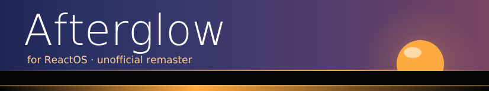

## Boot logo

`boot/boot-logo.svg` is the vector master of the logo on the ReactOS kernel boot screen, `boot/palette.json` is the 16-colour palette of that whole screen, and `boot/render.py` renders the master to the 414 × 366 bitmap the kernel resource needs, uncompressed and RLE4 (needs `rsvg-convert` and Pillow). The patch into the kernel is not made here. See `docs/reactos-desktop-boot.md`.

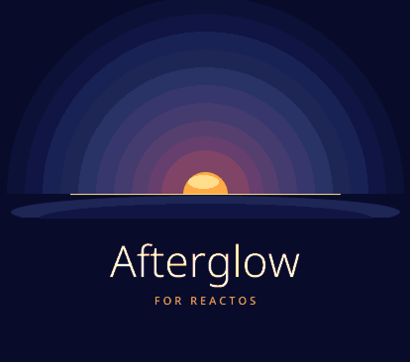

## Icons

`icons/gen_e.py` (with `icons/folders_g.py`, the folder family it imports) draws the 73 Afterglow icons as SVG masters (`icons/svg/`, committed; `icons/sheet.svg` is the contact sheet), `icons/arrows.py` draws the shortcut arrow masters (`icons/arrow/`), and `icons/render.py` renders them to `.ico` files with 16, 32 and 48 px frames and PNGs (needs `rsvg-convert` and Pillow). `icons/map.json` maps each icon id to the ReactOS icon it replaces, with only the verified resource ids filled in. `icons/SHA256SUMS` records the `.ico` files and `icons/SHA256SUMS.masters` the masters, and `bun run check:desktop` checks both. See `docs/reactos-desktop-icons.md`.

```sh
python3 desktop/icons/render.py desktop/build/icons
```

## Start orb and menu banner

`start/orb.svg` and `start/banner.svg` are the vector masters of the Start button orb (bitmap 143) and the Start menu banner (bitmap 158) in `explorer.exe`, and `start/render.py` renders them to the resource-ready DIBs (needs `rsvg-convert` and Pillow). The orb keeps a margin inside the 20 × 20 square explorer shows. The patch into the explorer is not made here. See `docs/reactos-desktop-start.md`.

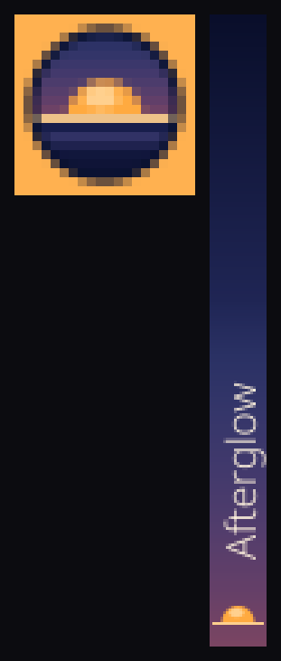

## SVG masters

The pointers that ship are the 32 × 32 raster files from the generator. `desktop/` also holds vector masters of the same 14 pointers in `pointers/svg/`, drawn from the same shape definitions (polygons, circles and strokes) in a 32 × 32 viewBox, so the art survives a larger size or a new target. They are reference art: raster is what ships (`.cur`, `.ani`, and the sheet above), vector is the scalable source.

| 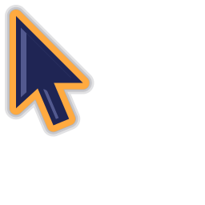 | 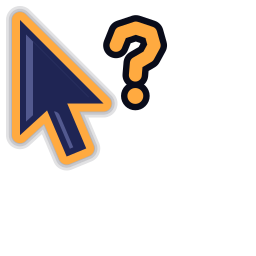 | 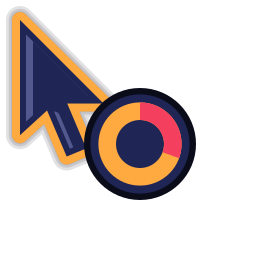 | 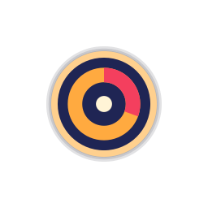 | 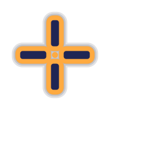 | 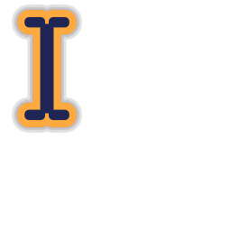 | 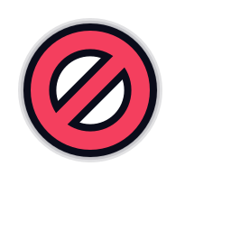 |
| ----------------------------------------------------------------- | --------------------------------------------------------------- | --------------------------------------------------------------------- | --------------------------------------------------------------- | --------------------------------------------------------------------- | ---------------------------------------------------------------- | -------------------------------------------------------------------- |
| Arrow                                                             | Help                                                            | Working                                                               | Busy                                                            | Crosshair                                                             | Text                                                             | Unavailable                                                          |

|  | 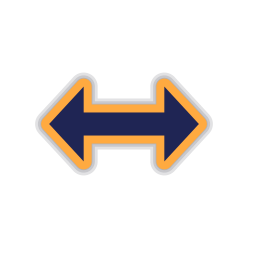 | 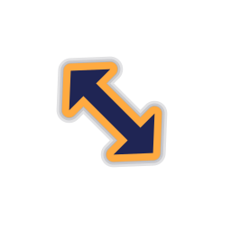 | 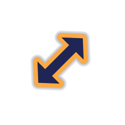 | 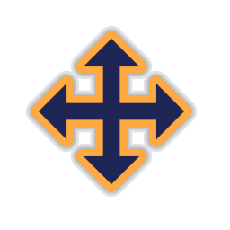 | 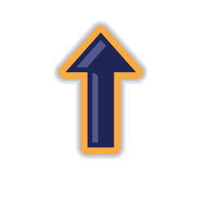 | 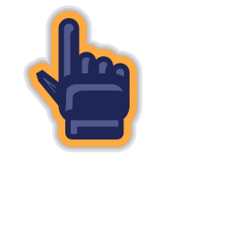 |
| ----------------------------------------------------------------------------- | ------------------------------------------------------------------------------- | ---------------------------------------------------------------------------- | ---------------------------------------------------------------------------- | --------------------------------------------------------------- | ----------------------------------------------------------------- | --------------------------------------------------------------- |
| Resize vertical                                                               | Resize horizontal                                                               | Resize NW-SE                                                                 | Resize NE-SW                                                                 | Move                                                            | Up arrow                                                          | Hand                                                            |

_The vector masters, rendered by your browser (not the shipped raster)._

- **Idealised, not pixel-identical.** The raster reduces from 8× supersampling and filters its rim, halo and highlight; the SVG says the same with strokes and a few translucent layers. At 32 × 32 the two overlap about 87% on average (the diagonal resizes, the move pointer and the crosshair differ most, in rim shape and edge pixels).
- **Hot spot.** Each file carries `data-hotspot="x,y"` and says it in its `<title>` and `<desc>`, in the pointer's own pixel grid.
- **Animations.** `afterglow-working-animated.svg` and `afterglow-busy-animated.svg` turn the travelling arc with SMIL (eight steps, 0.1 s each, as in the `.ani` files). The eight frames of each are in `pointers/svg/frames/`.
- **Generated.** `python3 desktop/pointers/gen-cursors.py OUT_DIR --svg desktop/pointers/svg` rewrites them, and `bun run check:desktop` regenerates and compares them with the committed files. Edit the generator, not the SVGs.
