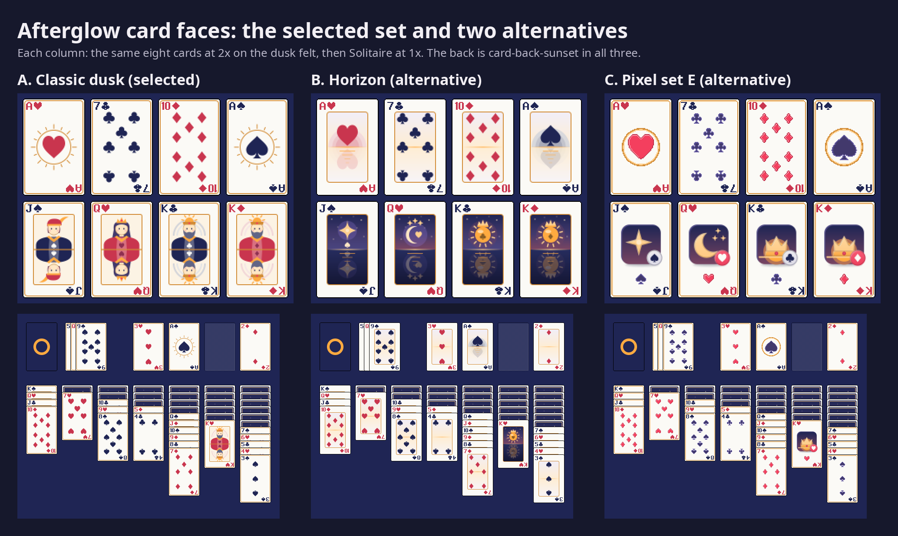

# Card faces

The Afterglow faces for `cards.dll`, which Solitaire and Spider Solitaire draw through cardlib: the 52 faces (bitmaps 1 to 52, suit order clubs, diamonds, hearts, spades, ace to king), `FreeCard` (53) and the Joker (66), all 72 × 112. The selected set is **Classic dusk** (`classic.py`); two review-only alternatives, **Horizon** and **Pixel set E**, are in `../alternatives/faces`. The back stays `card-back-sunset`. See [the card art](../../../docs/reactos-desktop-cards.md) for the render, the hashes and the patch.

## Classic dusk (selected)

The traditional layout on a cream face in a thin gold border. Hearts and diamonds are rose (`#c9354e`, 4.9:1 on the face), spades and clubs dusk indigo (`#1f2554`, 13.9:1). Each ace is its suit in a gold sun ring. The courts are double-ended figures drawn once and coloured by suit: the king wears a rising-sun crown, the queen a tiara and the jack a feathered cap. The joker is a double-ended jester. The free cell has no index and carries the Afterglow sun on its horizon under the dusk arcs. The contact sheet is [sheets/card-faces-classic.png](sheets/card-faces-classic.png).

- **Index in both corners.** Rank and small suit sit side by side at the top left (rows 4 to 12) and the same, turned, at the bottom right. A Solitaire row overlaps by 16 rows and a Spider row by 17, so the top-left index is what shows of a covered card. The waste fans by 12 columns, which still shows the rank. The top card of a pile shows whole, with both corners. The ranks are a bold 9-pixel bitmap font and the small suits 9 × 9 bitmaps, hinted by hand in `faces.py`.
- **Colour blindness.** Rose and indigo differ in lightness as well as hue, and the four suits differ in shape. Measured through Machado 2009 simulations, the rose-to-indigo contrast is 3.4:1 for deuteranopia, 2.0:1 for protanopia (where the hue difference, olive against navy, carries the rest) and 2.8:1 for tritanopia. The sheets show each simulation and greyscale.

## Alternatives (review only)

| Set         | What it is                                                                                                                                                                                                                                                           | Sheet                                                                         |
| ----------- | -------------------------------------------------------------------------------------------------------------------------------------------------------------------------------------------------------------------------------------------------------------------- | ----------------------------------------------------------------------------- |
| Horizon     | The pips on a faint dawn sky with a gold horizon line, framed like the back. Each ace is its suit rising as the sun over the dusk arcs. The courts are night panels: the crowned sun, the moon and the evening star, reflected in the water. The joker is an eclipse | [card-faces-horizon.png](../alternatives/faces/sheets/card-faces-horizon.png) |
| Pixel set E | Hand-hinted 12 × 12 pixel pips in the icon set's rose and dusk materials, with the keyline. The courts are icon tiles on the dusk plate, drawn with `gen_e.py`'s Pen. The border is a stepped gold ring                                                              | [card-faces-pixel.png](../alternatives/faces/sheets/card-faces-pixel.png)     |

Their SVGs are not committed. `gen_faces.py --alternatives OUT_DIR` writes them, and `../alternatives/faces/SHA256SUMS` holds their hashes, which `bun run check:desktop` checks.

## Files

- `faces.py`: the shared parts (cards.dll's order, cardlib's geometry, the suit outlines, the pip layouts, the index font, the SVG writer)
- `classic.py`: the selected set. `../alternatives/faces/horizon.py` and `pixel.py` hold the alternatives
- `gen_faces.py OUT_DIR`: writes the 54 selected masters (`NN-<suit>-<rank>.svg`, `53-free-cell.svg`, `66-joker.svg`, where NN is the cards.dll bitmap). `--alternatives OUT_DIR` writes the alternatives
- `NN-*.svg`: the selected masters, hashed in `../SHA256SUMS.masters` and rendered by `../render.py`
- `render_sheets.py OUT_DIR [--stock DIR]`: the contact sheets and the overview (needs rsvg-convert, Pillow and numpy). `--stock` adds the stock faces as a reference column; they are only shown, never drawn from, and the committed overview leaves them out
- `sheets/`: the review sheets of the selected set and the overview
