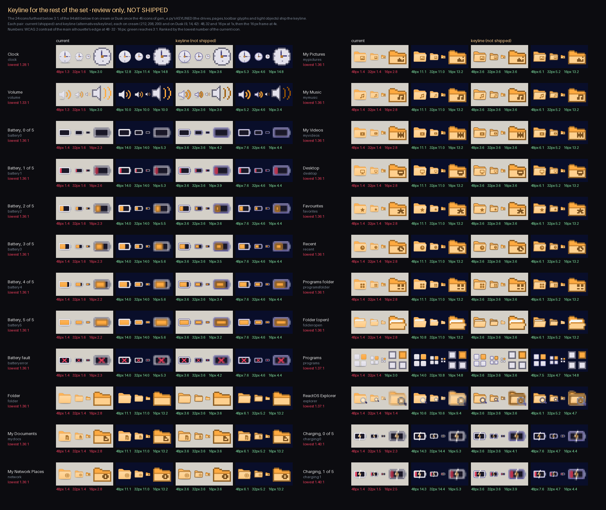

# Icon alternatives (review only)

## Chosen and shipped: the device redraws

The owner chose to show the device for the five icons that showed the medium or a part instead of the device: CD drive, Floppy, Removable drive, RAM disk and My Computer. The first device drawings put the old medium on a generic drive box and did not read, so the four drives were drawn again as the objects themselves: a slim optical drive with a disc on its open tray, a floppy drive with a disk going into its slot, a USB flash drive on the diagonal, and a memory chip with a disk platter on its lid (`docs/reactos-desktop-icons.md` says why each). My Computer stays the monitor with its system unit. They are the masters in `gen_e.py` and `gen_v2.py` under the original ids, each with a hand-tuned 16 px frame. The old art stays in the set under its own ids (`cd-disc`, `floppy-disk`, `usb-key`, `ram-module` and `monitor`), unmapped, for media and storage lists. The keyline variants of the five are the keyline of the shipped art, like the rest of the set.

## Chosen and shipped: the keyline on the drives and the light-ground tier

Hard disk, Floppy, Removable drive, RAM disk and My Computer ship with the keyline, because ReactOS shows them on light windows and Local Disk read pale there. Then the owner chose the tier recommended in the keyline-rest review, and it ships it too: the 14 icons drawn on a page, the 17 Explorer toolbar glyphs (at 48, 32, 24 and 16 px) and the light objects of the white file windows (both Recycle Bins, Program, the two network drives, CD disc, Floppy disk, USB key and Monitor). The keyline is drawn by `gen_e.py` itself (`KEYLINED`, and `KEYLINED_16` for the hand-tuned 16 px frames that are below 3:1 without it: Removable drive, the page icons and Views), so their variants in `keyline/` are the shipped drawings, except a hand-tuned 16 px frame that reaches 3:1 without it, which keeps its review variant there. CD drive reaches 3:1 without it. `docs/reactos-desktop-icons.md` has the numbers before and after, and `python3 alternatives.py --tier OUT_PNG BEFORE_SVG_DIR` draws the tier before and after from an `svg/` folder of the release before.

Nothing else in this folder ships. These are alternatives to icons in the Afterglow set, kept for the owner to pick from per icon. They are not in `map.json`, not rendered by `render.py`, not in the release zip and not in the recorded sums. When a pick is made, it moves into the generators (`gen_e.py`, `gen_v2.py`) and the sums are updated there.

`alternatives.py` is the generator: `python3 alternatives.py` rewrites the masters here, `python3 alternatives.py --review OUT_PNG` renders every frame at 16, 32 and 48 px and draws the review sheet, [`docs/images/afterglow-icons-alternatives.png`](../../../docs/images/afterglow-icons-alternatives.png), and `python3 alternatives.py --rest OUT_PNG` draws the keyline-rest sheet below.

| Folder or file     | What                                                     |
| ------------------ | -------------------------------------------------------- |
| `keyline/`         | Every icon in the set with the keyline                   |
| `keyline-rest.png` | The keyline-rest review sheet (review only, not shipped) |

The folder holds the 48 px master `ID.svg`, the `32/` and `16/` profiles, and a hand-tuned `ID-16.svg` where the icon has one.

## The keyline

The keyline is set E's own clipped inner edge, made opaque and retuned in each material's hue to a luminance of about 0.137, about 1.5 screen pixels wide at 32 and 16 px. The classic cream window colour has a luminance of about 0.62 and the Dusk desktop about 0.006, and that band is the one that reaches 3:1 against both. Plates get a rim in the same way, a little lighter, because on cream the plate's dark body already carries the contrast. Hinted 16 px frames get the retune on their outer ring of pixels, and Keyboard layout has a hand-tuned 16 px frame here, because its scripted frame is too thin to carry it (Views' ships in `hint16_v2.py`).

## How contrast is measured

WCAG 2 contrast against the ground, at the edge of the icon's main silhouette: the pixels of at least 50 % alpha, so the soft contact shadow is left out. Each pixel on the silhouette's outer ring is scored with the stronger of itself and the pixel just inside it, because an anti-aliased curve leaves the outermost pixel part ground. The icon's score is the median over the ring, and the sheet shows the worst of its 48, 32 and 16 px frames. Every keyline alternative reaches 3:1 on both grounds at every size.

## The rest of the set: review only, not shipped

_The keyline-rest sheet: review only, nothing on it ships._

With the drives and the tier keylined, 94 of the 140 icons are still below 3:1 on one ground: 43 on cream and 51 on Dusk (the dusk plate of the apps and applets). The sheet shows the 24 furthest below it, all on cream: Clock and Volume, the battery and charging levels, the M1 folders, the Programs item of the Start menu and ReactOS Explorer. With the keyline every one reaches at least 3.2:1 on cream and stays above 3:1 on Dusk.

They stay as they are, by the owner's decision. The tray glyphs (Volume, Clock, the batteries) sit on the near-black taskbar, where they already pass. The plated apps and applets fail only on Dusk: their plates reach 6 to 10:1 on cream and white, and on the desktop the glyph on the plate carries them. The M1 folder family (My Documents is 1.4:1 on cream) and ReactOS Explorer, drawn on the M1 folder, keep the chosen M1 design. The dialog badges and the Start menu items below 3:1 on cream are not in the tier either.
