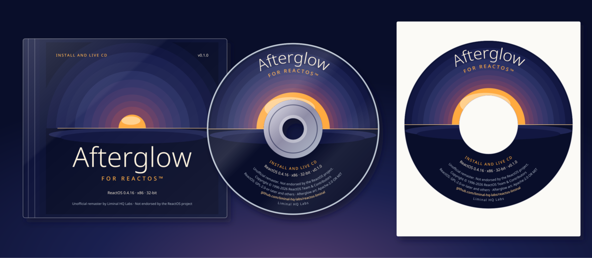
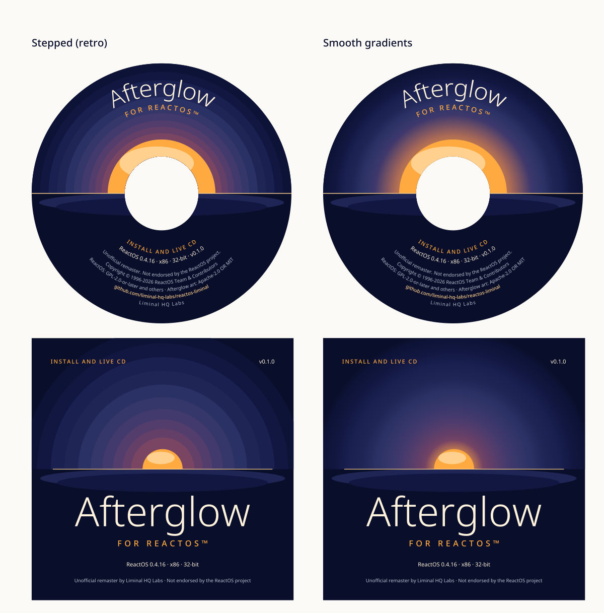

# Afterglow for ReactOS CD media

A printable media set for the Afterglow for ReactOS remaster: the disc art, a full-face CD label, the jewel case front insert and back tray card, all as vector masters with scripted print-ready PDFs, in two styles: **stepped**, flat bands in the retro 16 and 256 colour look of the boot logo, and **smooth**, the same colours as continuous gradients. The masters and their generator live in `desktop/cd-media/`; the PDFs and previews are generated into `dist/cd-media/` and are never committed.



## The disc compositions

Three compositions share one language with the boot logo: the half-set sun, the dusk bands and the pale gold horizon over the night.

| Composition  | What it does                                                                                                                                                                                                                                                        | Status       |
| ------------ | ------------------------------------------------------------------------------------------------------------------------------------------------------------------------------------------------------------------------------------------------------------------- | ------------ |
| **B · Halo** | The boot logo turned into the disc. The sun sits behind the hub, half set on a horizon through the centre, so the clear hub reads as the sun's middle; the bands ring it out to the rim; the title arches over the top and the small print curves under the horizon | **Selected** |
| A · Sunrise  | The sun rises from the bottom rim and its bands sweep up past the hub; the fine print runs round the top rim, the title arches over the hub, the media line sits under the horizon                                                                                  | Alternative  |
| C · Horizon  | A level horizon below the hub with the stepped sky of the stepped wallpapers above and the sun setting to the right; the wordmark sits straight over the hub and the small print curves under the horizon                                                           | Alternative  |

Halo is selected because it is the only one that is truly radial: the hole becomes part of the picture instead of a gap in it, it keeps the boot logo's symmetry, so the disc, the boot screen and the cover read as one family, and it leaves the most room for the small print in the dark lower half, where it has the best contrast. The label uses Halo too. The alternatives stay rendered beside it.

## Two styles: stepped and smooth

Every piece is drawn in both styles, named as the desktop wallpapers name theirs. Only the sky changes: the layout, the words, the sizes, the sun, the horizon sheets and every mark are the same, and the test checks that.

| Style     | The sky                                                                                                                                                                             | Print it when                                                                                                                                          |
| --------- | ----------------------------------------------------------------------------------------------------------------------------------------------------------------------------------- | ------------------------------------------------------------------------------------------------------------------------------------------------------ |
| `stepped` | Flat bands of the boot logo's colours: concentric rings round the sun, or level stripes for Horizon. The retro 16 and 256 colour look of the boot screen and the stepped wallpapers | You want the old-school look, or the printer has few colours or bands gradients (a thermal disc printer, an office laser, a print shop's spot colours) |
| `smooth`  | One gradient through the same colours, each at the middle of its stepped band, fading into the night past the outermost band, with a soft gold glow round the sun                   | Photo-quality printing on an inkjet or at a print shop, and for screens                                                                                |



## Specifications

| Piece            | Master                                                                              | Artboard     | Trim and print area                                                                                             | Bleed                               | Text safe area                     |
| ---------------- | ----------------------------------------------------------------------------------- | ------------ | --------------------------------------------------------------------------------------------------------------- | ----------------------------------- | ---------------------------------- |
| Disc art         | `disc.svg` (Halo), `alternatives/disc-sunrise.svg`, `alternatives/disc-horizon.svg` | 120 × 120 mm | Printable 118 mm outer, 41 mm inner; the art runs to the 120 mm edge and stops at 41 mm, so the hub stays clean | 1 mm past 118 mm                    | 46 to 112 mm                       |
| CD label         | `label.svg`                                                                         | 123 × 123 mm | 117 mm full face, 41 mm hole                                                                                    | 3 mm outward and 3 mm into the hole | 46 to 112 mm                       |
| Jewel case front | `jewel-front.svg`                                                                   | 124 × 124 mm | 120 × 120 mm                                                                                                    | 2 mm                                | 3 mm inside the trim               |
| Back tray card   | `jewel-back.svg`                                                                    | 154 × 122 mm | 150 × 118 mm: a 6 mm spine, the 138 mm back, a 6 mm spine                                                       | 2 mm                                | 3 mm inside the trim and the folds |
| Mock-up          | `mockup.svg`                                                                        | 412 × 180 mm | Not for print                                                                                                   | —                                   | —                                  |

Each master is in `desktop/cd-media/stepped/` and again in `desktop/cd-media/smooth/` under the same name. Each disc master also carries a guide layer (the `guides` group, `data-print="no"`) marking the 120 mm edge, the 118 mm printable limit, the 117 mm label, the 112 mm and 46 mm safe circles, the 41 mm hole, the 33 mm stacking ring and the 15 mm spindle hole. The label, front and tray card masters mark their cut, bleed, trim and folds the same way. `render.py` removes the guides before anything is printed.

**Type.** All text is outlined from Noto Sans (Light for the wordmark, as on the boot logo; Regular and Medium for the rest), so no font is needed to open or print a master. The smallest type anywhere is 6.5 pt and nothing may be set under 6 pt: the generator refuses it and a test checks every text path. The fine print on the disc and label is 6.5 pt, the media and system lines 7.5 pt.

**Colour.** Every colour is an Afterglow colour: the 16 colours of the boot logo palette (`desktop/boot/palette.json`, read by the generator) and a few more Afterglow colours named in `EXTRA_COLOURS`: the soft grey of the About banner's type, the paper and indigo of the icon set, and the rose horizon and stepped sun of afterfetch's Afterglow logo, which marks the afterfetch line on the tray card. The stepped bands are flat colours, with no gradients to band or dither in print; the smooth gradients run only through those same colours, and the sky of each piece sits in its own `scene` group so the print render can treat it on its own.

## The words, and the branding rules

The media follow the branding rules for the remaster: it is an unofficial remaster and must say so.

- **Name.** "Afterglow for ReactOS": lead with Afterglow and use ReactOS only descriptively. The ™ follows the first ReactOS on each piece (`FOR REACTOS™`).
- **Unofficial.** The disc and label say "Unofficial remaster. Not endorsed by the ReactOS project."; the front says "Unofficial remaster by Liminal HQ Labs · Not endorsed by the ReactOS project"; the tray card says it is not made, endorsed or supported by the ReactOS project and that ReactOS™ is a trademark of the ReactOS project.
- **No ReactOS logo.** No ReactOS logo, orb or wordmark art appears anywhere. The sun is Afterglow's own.
- **Copyright.** "Copyright © 1996-2026 ReactOS Team & Contributors" appears byte for byte on the disc, the label and the tray card. It is a notice, not branding.
- **Licences.** ReactOS is GPL-2.0-or-later with parts under the LGPL 2.1 and other licences, and the licence texts are in the `LICENSES` folder on the disc; the Afterglow art and the remaster's own scripts are Apache-2.0 OR MIT. The disc and label carry the short form ("ReactOS: GPL-2.0-or-later and others · Afterglow art: Apache-2.0 OR MIT"); the tray card carries the paragraph and the source pointer.
- **Media.** "Install and live CD" and "ReactOS 0.4.16 · x86 · 32-bit". Nothing on the media mentions an ISO.
- **Source.** `github.com/liminal-hq-labs/reactos-liminal`.
- **Version.** `VERSION` at the top of `gen_media.py` (`v0.1.0` today). Change it there and regenerate; it appears on the disc, the label, the front, the tray card and both spines.

The tray card's contents panel ("What is on this disc") lists the boot menu entry "ReactOS (Afterglow)", the Afterglow desktop, icons, pointers, boot logo and logon banner, the full ReactOS applications and games (nothing is trimmed from this build), the afterfetch command, Wine Gecko, and the `LICENSES` folder with `NOTICE.txt` and `CHANGES.txt`. Keep it in step with what the reactos-liminal recipe actually builds.

## Regenerating

```sh
python3 desktop/cd-media/gen_media.py desktop/cd-media   # the masters of both styles (needs Noto Sans)
python3 desktop/cd-media/render.py dist/cd-media         # the PDFs and previews of both styles (needs rsvg-convert, numpy and Pillow)
node --test scripts/render-cd-media.test.mjs              # geometry, colours, wording, sizes, styles, drift and the render
```

Both scripts take `--style stepped` or `--style smooth` to draw or render one style only. The render is deterministic: run twice, it writes the same bytes.

Edit the generator, never a master: the test regenerates the masters when Noto Sans is installed and fails if they differ. The generator looks for `NotoSans-Light.ttf`, `NotoSans-Regular.ttf` and `NotoSans-Medium.ttf` in the usual font folders, or in a folder given as its second argument. `render.py` reads only the committed masters, so it needs no font (and the stepped style needs nothing but `rsvg-convert`); the contact sheet's captions are outlined when Noto Sans is installed and left out otherwise.

`render.py` writes these to `dist/cd-media/stepped/` and again, with the same names, to `dist/cd-media/smooth/`, and the two styles side by side to `dist/cd-media/stepped-vs-smooth.png`:

| File                                                                                    | What                                                                                                                   |
| --------------------------------------------------------------------------------------- | ---------------------------------------------------------------------------------------------------------------------- |
| `disc-art.pdf`                                                                          | The selected disc for a printable disc or a disc printer's tray software, on a 120 mm page with no marks               |
| `disc-label-A4.pdf`, `disc-label-Letter.pdf`                                            | Two labels a sheet with crop marks and the hole punch ring, for two-up label stock                                     |
| `disc-label-single-A4.pdf`, `disc-label-single-Letter.pdf`                              | One label in the top position of the same sheet                                                                        |
| `disc-label-single.pdf`                                                                 | One label on a 138 mm page cut to it, with crop marks, for a print shop                                                |
| `disc-label-plain-A4.pdf`, `disc-label-plain-Letter.pdf`                                | Two labels for plain paper or uncut sticker paper, with the cut circles and a compass centre drawn on                  |
| `jewel-case-front.pdf`, `jewel-case-back.pdf`                                           | The front insert and tray card on pages cut to them, with crop marks and the spine folds                               |
| `jewel-case-front-A4.pdf` and `-Letter.pdf`, `jewel-case-back-A4.pdf` and `-Letter.pdf` | The same on A4 and Letter                                                                                              |
| `preview.png`, `contact-sheet.png`, `png/*.png`                                         | The mock-up, every part side by side at its actual proportions, and each master at 150 dpi with and without its guides |

The stepped PDFs are vector throughout (`rsvg-convert -f pdf`): no raster images, so they print sharp at any resolution. In the smooth PDFs each piece's sky is one 300 dpi sRGB image with a little seeded noise, under the vector sun, sheets, horizon, marks and outlined text, and inside the vector cut and hole; see the decisions below. The colour space, the page sizes, the bleed, the crop and fold marks, the hole and the safe ring are the same in both.

## Printing

**Label stock.** The label is drawn for the common two-up full-face CD/DVD label: about 117 mm across with a 41 mm centre hole. Products sold this way include Avery 5931, 8931 and 8692 on US Letter, Avery L7676 on A4, and Neato-compatible full-face labels. Sizes vary by a millimetre or two between products, and some have a small 17 mm hole instead of 41 mm, so measure your stock. The label positions on the A4 and Letter sheets are set in `LABEL_SHEETS` at the top of `render.py`; check them against your sheet's own template and change the centres there if they differ.

**Which style.** Print `stepped` for the retro look, or on a printer with few colours or one that bands gradients: flat bands print as clean areas of colour on anything. Print `smooth` for photo-quality output on an inkjet with photo or glossy label stock, or at a print shop. Each set is complete on its own; do not mix them on one disc and case unless you mean to.

**Settings.**

- Print at **100 %** (actual size). Turn off "Fit to page", "Shrink oversized pages" and any borderless enlargement.
- Choose the paper type that matches the stock (glossy or matte label, or plain paper) and the best quality setting.
- The art is sRGB. Let the printer driver manage colour, or use the stock maker's profile if it has one; do not apply a second conversion. The dark night bands use a lot of ink, so let a glossy label dry before handling it.
- **Test on plain paper first.** Print the label sheet on plain paper, lay it over a label sheet and hold both up to a light: the labels must sit inside the crop marks and the punch ring on the die-cut hole. Adjust `LABEL_SHEETS` or the printer's offset until they do.
- For plain paper or uncut sticker stock, print the `plain` version and cut along the drawn circles, ideally with a compass cutter set on the centre cross.
- The jewel case pieces trim at the crop marks; fold the tray card's spines at the dashed fold marks.

**Printable discs.** Use `disc-art.pdf` in the disc printer's software and set its inner and outer diameters to the disc's printable area. The art bleeds 1 mm past 118 mm and stops at 41 mm.

**Not checked.** No physical print has been made yet: check the first print against real stock before printing a batch.

## Design decisions

- **Two styles, one drawing.** The media come in stepped and smooth, like the desktop wallpapers, because the stepped bands are the boot logo's retro look and suit an old-school print or a printer with few colours, while photo printing and screens show off continuous gradients. One `style` argument switches the sky everywhere in the generator; nothing else differs, so the two sets cannot drift apart, and a test compares them with the sky taken out.
- **Smooth gradients go through the stepped colours.** Each gradient puts a stop at the middle of each stepped band, in that band's colour, as the smooth wallpapers do, so smooth reads as the stepped sky with its edges blended and no new colour enters the palette. The sun gets a soft gold glow in the smooth style only, since there the bands no longer step up to it.
- **Smooth skies print as dithered images.** A dark gradient spread over 120 mm has only a few dozen 8-bit levels per channel, and a PDF shading is rasterised by whatever printer or driver receives it, so it may band. The print render draws each smooth sky at 300 dpi, adds triangular noise of one 8-bit level seeded by the file name (the wallpapers' dither), and places it as one sRGB image. The masters stay vector, and in the PDFs everything but the sky stays vector: the text is outlined paths, and the label cut, the disc's hole and print limits are vector clips over the image, so the edges stay sharp. The previews get the same noise at their own size, because scaling a dithered image down averages the noise away.
- **Stepped stays vector.** Flat bands cannot band, so the stepped PDFs have no images at all.
