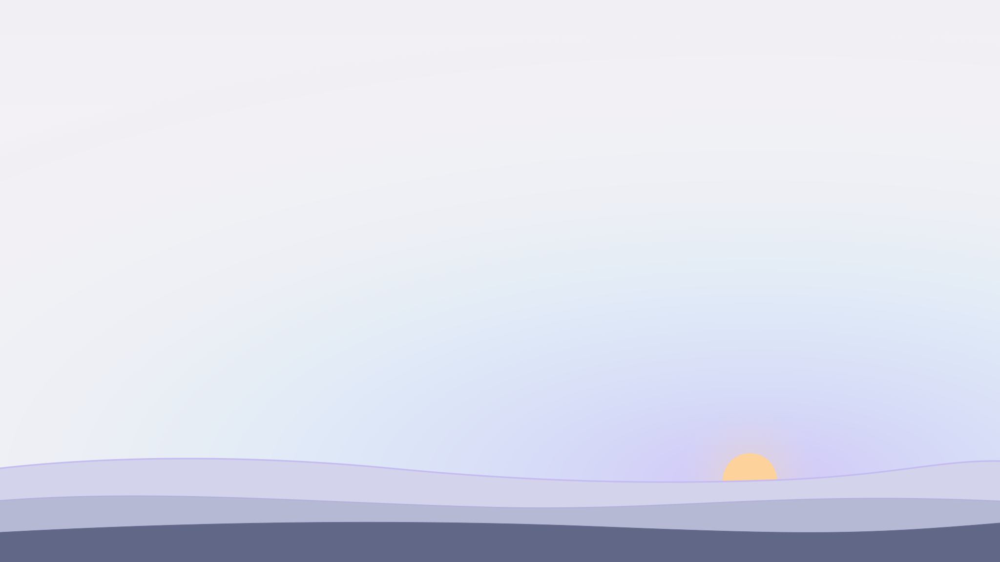
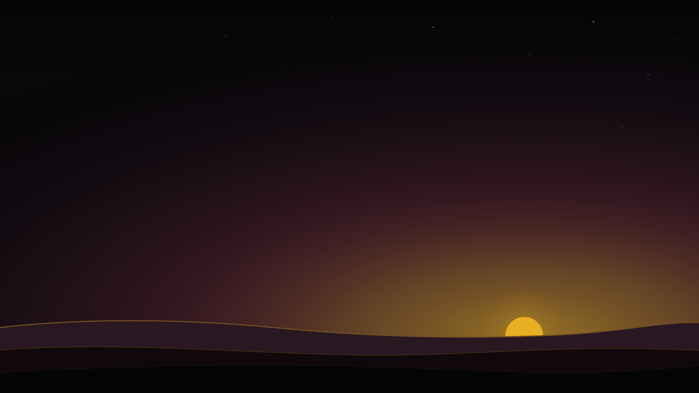
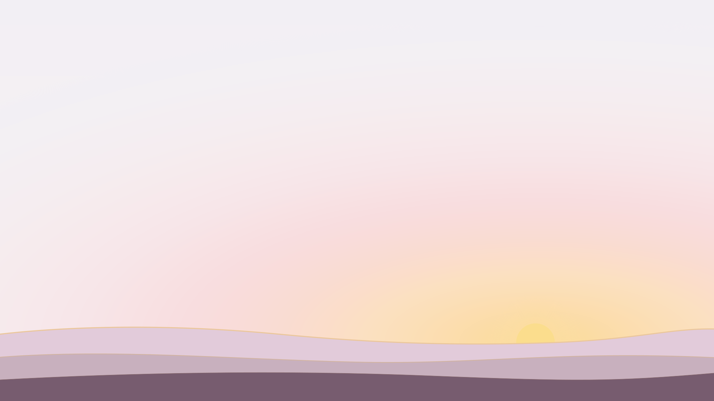
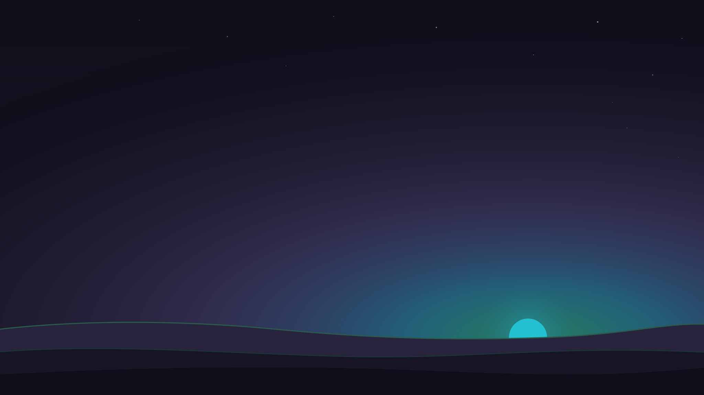
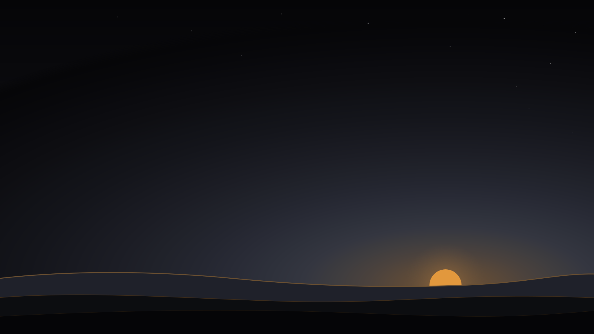

# Desktop wallpapers

Afterglow has desktop wallpapers too: one quiet dusk scene drawn in every Afterglow palette, in dark and light, with flat stepped bands or smooth gradients. A low sun sets in the lower right third behind three layered horizons, like stacked sheets of paper, and its glow fades out across the sky, so the centre of the screen stays calm for desktop icons and the bottom stays even for a taskbar.

| Palette    | Dark                                                                                                 | Light                                                                                                  |
| ---------- | ---------------------------------------------------------------------------------------------------- | ------------------------------------------------------------------------------------------------------ |
| `dusk`     |          |          |
| `indigo`   |      |      |
| `ember`    |        |        |
| `aurora`   |      |      |
| `graphite` |  |  |

- **`dusk`** is the signature scene: orange, rose and purple over the `#050507` void, and a peach, rose and lilac glow on warm paper in light mode.
- **`indigo`** matches `afterglow-dark`: deep indigo-black with purple and blue, and the same hues on paper.
- **`ember`** is a hotter sunset: gold, orange and rose.
- **`aurora`** is a cool polar glow: green, cyan and blue, fading to purple.
- **`graphite`** is a near-neutral slate glow with a faint warm sun.

## Files

The sources are SVG files in `assets/wallpapers/`, named `afterglow-<palette>-<mode>-<style>.svg`, on a 3840×2160 canvas with no external resources. They are generated by `scripts/build-wallpapers.mjs` from the shared palette, like the themes, so edit the generator and run `bun run build`, never the SVG. The generator draws one scene and fills it from a palette table, so a new palette is one more entry in `WALLPAPER_PALETTES`.

The PNG and BMP renders are not committed. `bun run render:wallpapers` writes them to `dist/wallpapers/` (it needs `rsvg-convert` from librsvg and ImageMagick 7's `magick` on the `PATH`):

- `png/<name>-3840x2160.png`, `-2560x1440.png` and `-1920x1080.png`, each rendered from the SVG at that size
- `png/<name>-3840x2160-nodither.png` for the smooth wallpapers: the undithered render, for your own processing
- `bmp/<name>-1024x768.bmp`: a 24-bit BMP of the centre 4:3 crop (x 480 to 3360 on the canvas), scaled with Lanczos, for ReactOS and other 4:3 desktops
- `contact-sheet.png` (every wallpaper) and `compare-stepped-smooth.png` (stepped beside smooth at 100%, around the sun)

`--only <text>` renders only the names that contain it, `--seed <n>` changes the dither pattern, and `--no-bmp` skips the BMPs.

## Stepped or smooth

- **Stepped** wallpapers draw the sky and the glow as flat bands of a few levels each. They look the same in any renderer and at any scale, and cannot band, so use them on 16-bit and 256-colour displays, at tiny sizes, and anywhere the system dithers or maps the image to a palette.
- **Smooth** wallpapers blend the same colours continuously, for 24-bit and 32-bit displays. The sky is one vertical gradient and the glow one radial gradient, with a stop at the middle of each stepped band in that band's colour. A smooth dark gradient still bands at 8 bits per channel, so the renderer adds a very light triangular dither of about ±1 level per channel after rendering. Each size is rendered and dithered on its own, because scaling a dithered image averages the grain away and brings the bands back, and the BMPs are dithered after the crop and resize.

## Where the colours come from

Every colour is worked out from the roles in `scripts/palette.mjs`, and the constants that shape the scene (`WALLPAPER_PALETTES`, `LIGHT`, `SUN`, `GLOW` and `HORIZONS`) sit at the top of the generator. Each palette names a neutral ramp, a sun hue and the glow hues for each mode.

| Part                 | Dark mode                                                                                | Light mode                                                         |
| -------------------- | ---------------------------------------------------------------------------------------- | ------------------------------------------------------------------ |
| Sky at the top       | Neutral 900 (the page surface)                                                           | Paper 800                                                          |
| Sky at the horizon   | Neutral 800 with 5% of the last glow hue                                                 | Paper 900 with 4% of the last glow hue                             |
| Glow                 | The sky mixed towards the glow hues, strongest at the sun and fading as `(1 - r) ** 2.4` | The same, fading as `(1 - r) ** 2.3`, so paper takes a pastel tint |
| Sun                  | The sun hue lifted 20% towards the innermost glow band, with three halo steps            | The sun hue mixed halfway with paper, a pale gold                  |
| Horizons, back first | Neutral 800 with 10% and neutral 900 with 5% of the last glow hue, then neutral 900      | Paper 700, 600 and 400 with 10 to 14% of the deeper last glow hue  |
| Horizon edges        | Each sheet's colour mixed towards the first glow hue by 34%, 20% and 10%                 | The same                                                           |
| Stars                | Neutral 200 at 25 to 60% opacity                                                         | None                                                               |

The glow hues are the brand colours (each hue's step 200), and they travel outwards from the sun in order: for `dusk`, orange near the sun, then rose, then purple across the open sky. The outer bands mix towards the top sky colour, so the glow melts into the sky instead of drawing a dome. Light-mode horizons take the deeper hues from `deep`, which hold contrast on paper. The glow is strongest at the sun at 56% of the hue in dark mode and 46% in light mode, and 40% for `graphite`, whose grey would otherwise read as a smudge on paper. Each halo step around the sun is the glow under it lifted 14%, 26% and 40% towards the sun colour.

## Desktop icons and the taskbar

- **The calm centre:** the central 60% of the canvas (x 768 to 3072, y 432 to 1728) holds only the glow and the sky. `scripts/validate-wallpapers.mjs` samples it and checks that icon labels keep 4.5:1 contrast everywhere in it: white labels on the dark wallpapers (at least 5.7:1) and the paper theme's `#1c1b20` text on the light ones (at least 11.2:1). White labels on a light wallpaper rely on their drop shadow, as on any light desktop.
- **The taskbar:** the front horizon covers the whole bottom 96 pixels of the canvas (48 at 1080p), and white taskbar text keeps 4.5:1 on it in every wallpaper (at least 5.4:1 on the light ones, whose front horizon is a dark lavender grey). A top panel sits over the darkest (or, on paper, the coolest) part of the sky.
- **The sun** is centred at (2880, 1846) with a radius of 104 on the canvas, inside the 4:3 crop, so an app that wants to place its own emblem in the scene can put it there.

## Setting a wallpaper

- **ReactOS:** copy a `-1024x768.bmp` into `C:\ReactOS`, then open **Display Properties > Desktop**, choose **Browse** and pick it, positioned **Stretch** (or **Center** at 1024×768).
- **Windows:** right-click a PNG at your screen size and choose **Set as desktop background**, or pick it under **Settings > Personalisation > Background** with **Fill**.
- **GNOME:** `gsettings set org.gnome.desktop.background picture-uri file://$HOME/Pictures/afterglow-dusk-light-smooth-3840x2160.png` and the same with `picture-uri-dark` and a dark wallpaper, so the desktop follows the light and dark style.
- **KDE Plasma:** `plasma-apply-wallpaperimage ~/Pictures/afterglow-dusk-dark-smooth-3840x2160.png`.

## Checks

`bun run validate:themes` runs `scripts/validate-wallpapers.mjs`, which checks that every palette role names a real neutral ramp or brand hue, that the committed SVG files match what the palette generates (and that no extra file is in `assets/wallpapers/`), that each file is a self-contained 3840×2160 SVG with its licence header and only its palette's colours, and the icon label and taskbar contrast above. The validator checks colours and structure, not looks, so check a change by eye in the renders and the contact sheet.

## Licence

The wallpapers are dual-licensed under Apache-2.0 or MIT, like the rest of the repository, and each SVG carries its licence header.
