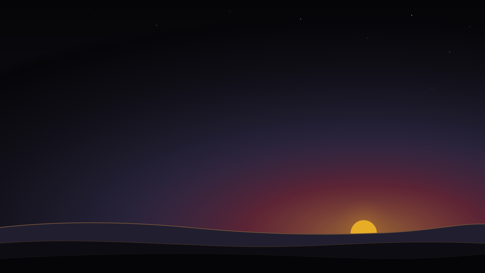
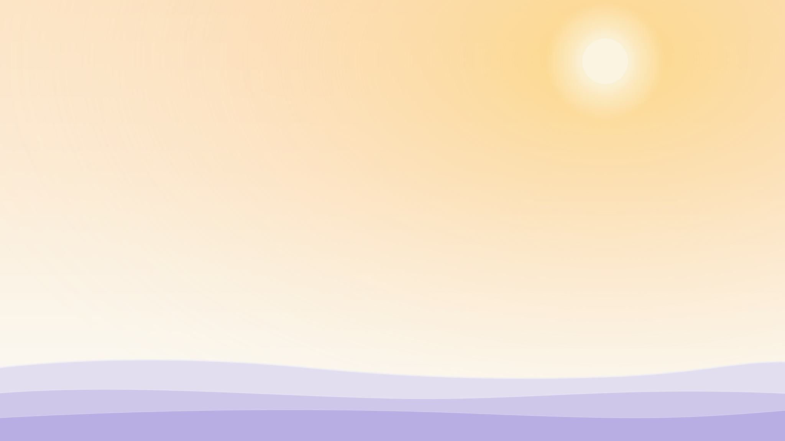
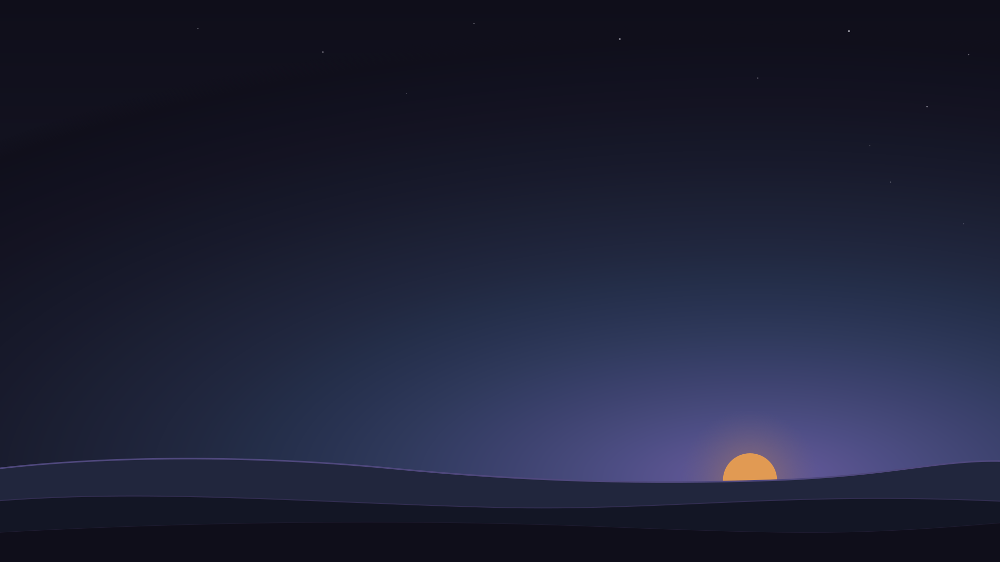
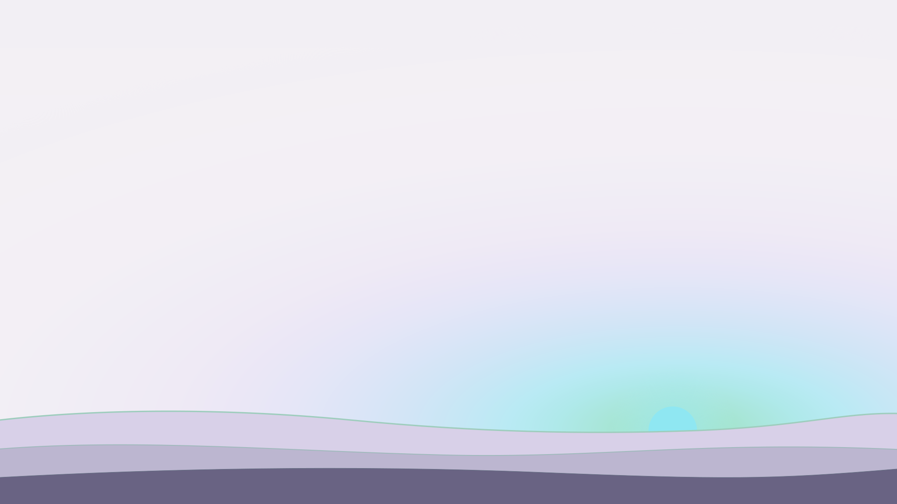
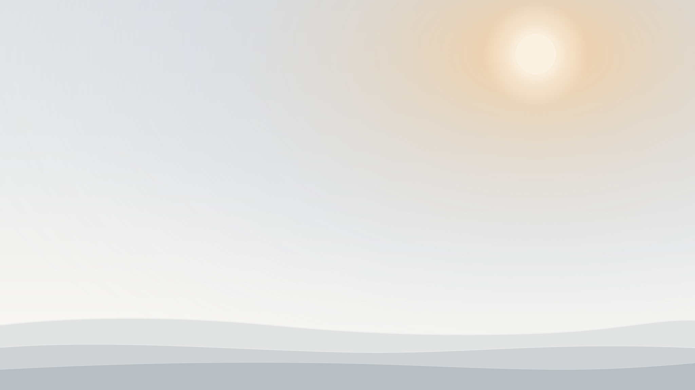

# Desktop wallpapers

Afterglow has desktop wallpapers too: one quiet landscape of three layered horizons, like stacked sheets of paper, drawn in every Afterglow palette, with flat stepped bands or smooth gradients. The two modes are the same place at two times of day, so a desktop that follows the system style moves from day to dusk with it:

- **Dark is dusk.** A low sun sets in the lower right third, half behind the back horizon, and its afterglow fades out across a dark sky with a few stars. A dark desktop wants a dark, quiet sky, and the setting sun is where the Afterglow name comes from.
- **Light is day.** The sun stands high and awake in the upper right, a bright paper-white disc with a soft halo, and its light washes across a pale sky tinted with the palette's hues, brightest and haziest low down over softly tinted hills. A light desktop wants a bright sky, and a sun half set on a pale sky read as a washed-out dusk rather than as daylight.

Either way the centre of the screen stays calm for desktop icons and the bottom stays even for a taskbar.

| Palette    | Dark                                                                                                 | Light                                                                                                  |
| ---------- | ---------------------------------------------------------------------------------------------------- | ------------------------------------------------------------------------------------------------------ |
| `dusk`     |          |          |
| `indigo`   |      |      |
| `ember`    |        |        |
| `aurora`   |      |      |
| `graphite` |  |  |

- **`dusk`** is the signature scene: orange, rose and purple over the `#050507` void at dusk, and by day a gold sun high in a warm gold and peach sky over lilac hills.
- **`indigo`** matches `afterglow-dark`: deep indigo-black with purple and blue at dusk, and by day a gold sun in a lavender sky over blue hills.
- **`ember`** is a hotter sunset of gold, orange and rose, and by day a hot gold sky over rose hills.
- **`aurora`** is a cool polar glow of green, cyan and blue fading to purple, and by day a pale sun in a clear cyan and blue sky over green hills.
- **`graphite`** is a near-neutral slate glow with a faint warm sun, and by day a soft warm sun in a pale slate sky over grey hills.

## Files

The sources are SVG files in `assets/wallpapers/`, named `afterglow-<palette>-<mode>-<style>.svg`, on a 3840×2160 canvas with no external resources. They are generated by `scripts/build-wallpapers.mjs` from the shared palette, like the themes, so edit the generator and run `bun run build`, never the SVG. The generator draws one scene and fills it from a palette table, so a new palette is one more entry in `WALLPAPER_PALETTES`.

The PNG and BMP renders are not committed. `bun run render:wallpapers` writes them to `dist/wallpapers/` (it needs `rsvg-convert` from librsvg and ImageMagick 7's `magick` on the `PATH`):

- `png/<name>-3840x2160.png`, `-2560x1440.png` and `-1920x1080.png`, each rendered from the SVG at that size
- `png/<name>-3840x2160-nodither.png` for the smooth wallpapers: the undithered render, for your own processing
- `bmp/<name>-1024x768.bmp`: a 24-bit BMP of the centre 4:3 crop (x 480 to 3360 on the canvas), scaled with Lanczos, for ReactOS and other 4:3 desktops
- `contact-sheet.png` (every wallpaper) and `compare-stepped-smooth.png` (stepped beside smooth at 100%, around the sun: the sky above it at dusk, and the sun itself by day)

`--only <text>` renders only the names that contain it, `--seed <n>` changes the dither pattern, and `--no-bmp` skips the BMPs.

## Stepped or smooth

- **Stepped** wallpapers draw the sky and the glow as flat bands of a few levels each. They look the same in any renderer and at any scale, and cannot band, so use them on 16-bit and 256-colour displays, at tiny sizes, and anywhere the system dithers or maps the image to a palette.
- **Smooth** wallpapers blend the same colours continuously, for 24-bit and 32-bit displays. The sky is one vertical gradient and the glow one radial gradient, with a stop at the middle of each stepped band in that band's colour (and, by day, its opacity). A smooth dark gradient still bands at 8 bits per channel, so the renderer adds a very light triangular dither of about ±1 level per channel after rendering. Each size is rendered and dithered on its own, because scaling a dithered image averages the grain away and brings the bands back, and the BMPs are dithered after the crop and resize.

## Where the colours come from

Every colour is worked out from the roles in `scripts/palette.mjs`, and the constants that shape the scene sit at the top of the generator: `WALLPAPER_PALETTES`, then `LIGHT`, `SUN`, `HALO` and `GLOW` for dusk, `DAY`, `DAY_SUN` and `DAY_GLOW` for day, and the shared `SKY_BANDS` and `HORIZONS`. Each palette names a neutral ramp, a sun hue and the glow hues for each mode, and its light mode also names a `sky` hue and a `hills` hue.

| Part                 | Dark mode (dusk)                                                                         | Light mode (day)                                                                                  |
| -------------------- | ---------------------------------------------------------------------------------------- | ------------------------------------------------------------------------------------------------- |
| Sky at the top       | Neutral 900 (the page surface)                                                           | Paper 900 with 26% of the sky hue                                                                 |
| Sky at the horizon   | Neutral 800 with 5% of the last glow hue                                                 | Paper 900 with 3% of the sky hue, the brightest part of the sky                                   |
| Glow                 | The sky mixed towards the glow hues, strongest at the sun and fading as `(1 - r) ** 2.4` | Sunlight: each glow hue lifted 35% towards paper, laid over the sky at `0.7 * (1 - r) ** 1.8`     |
| Sun                  | The sun hue lifted 20% towards the innermost glow band, with three halo steps            | Paper 900 with 10% of the sun hue, brighter than the sky, with halo steps of 35, 55 and 80% of it |
| Horizons, back first | Neutral 800 with 10% and neutral 900 with 5% of the last glow hue, then neutral 900      | Paper 900 with 16, 28 and 42% of the deeper `hills` hue                                           |
| Horizon edges        | Each sheet's colour mixed towards the first glow hue by 34%, 20% and 10%                 | Each sheet's colour lifted 55% towards paper, where the light from above catches the crest        |
| Stars                | Neutral 200 at 25 to 60% opacity                                                         | None                                                                                              |

At dusk the glow hues are the brand colours (each hue's step 200), and they travel outwards from the sun in order: for `dusk`, orange near the sun, then rose, then purple across the open sky. The outer bands mix towards the top sky colour, so the glow melts into the sky instead of drawing a dome. The glow is strongest at the sun at 56% of the hue, and 40% for `graphite`, whose grey would otherwise read as a smudge. Each halo step around the sun is the glow under it lifted 14%, 26% and 40% towards the sun colour.

By day the sky is lightest low down, where the air is hazy, and takes more of its hue towards the top. The sun's light is drawn as a translucent wash over the sky rather than as opaque colours, because it spreads from the top of the screen across every sky band, and an opaque glow would draw its edge across them. In the stepped wallpapers the wash is a set of flat rings, each at its own opacity, so every region is still one flat colour. The hills take the deeper hues from `deep`, which keep their colour on paper.

## Desktop icons and the taskbar

- **The calm centre:** the central 60% of the canvas (x 768 to 3072, y 432 to 1728) holds only the glow and the sky. `scripts/validate-wallpapers.mjs` samples it and checks that icon labels keep 4.5:1 contrast everywhere in it: white labels on the dark wallpapers (at least 5.7:1) and the paper theme's `#1c1b20` text on the light ones (at least 11.4:1). White labels on a light wallpaper rely on their drop shadow, as on any light desktop.
- **The taskbar:** the front horizon covers the whole bottom 96 pixels of the canvas (48 at 1080p), and a see-through taskbar's text keeps 4.5:1 on it in every wallpaper: white text on the dark wallpapers (at least 19:1) and `#1c1b20` text on the light ones (at least 7.6:1), as light desktop styles draw it. The daytime hills are soft tints, so white taskbar text on a light wallpaper needs the taskbar's own background, as on any light desktop. A top panel sits over the darkest part of the dusk sky, and above the daytime sun's disc.
- **The sun** is where an app can place its own emblem in the scene. At dusk it is centred at (2880, 1846) with a radius of 104 on the canvas, half set behind the back horizon. By day it is centred at (2960, 300) with a radius of 112, high in the upper right, above the calm centre (its disc ends at y 412) and inside the 4:3 crop; its halo reaches 2.6 radii. The validator checks that the daytime sun stays clear of the calm centre and inside the crop.

## Setting a wallpaper

- **ReactOS:** copy a `-1024x768.bmp` into `C:\ReactOS`, then open **Display Properties > Desktop**, choose **Browse** and pick it, positioned **Stretch** (or **Center** at 1024×768).
- **Windows:** right-click a PNG at your screen size and choose **Set as desktop background**, or pick it under **Settings > Personalisation > Background** with **Fill**.
- **GNOME:** `gsettings set org.gnome.desktop.background picture-uri file://$HOME/Pictures/afterglow-dusk-light-smooth-3840x2160.png` and the same with `picture-uri-dark` and a dark wallpaper, so the desktop follows the light and dark style.
- **KDE Plasma:** `plasma-apply-wallpaperimage ~/Pictures/afterglow-dusk-dark-smooth-3840x2160.png`.

## Checks

`bun run validate:themes` runs `scripts/validate-wallpapers.mjs`, which checks that every palette role names a real neutral ramp or brand hue, that the committed SVG files match what the palette generates (and that no extra file is in `assets/wallpapers/`), that each file is a self-contained 3840×2160 SVG with its licence header and only its palette's colours, and the icon label and taskbar contrast above. The validator checks colours and structure, not looks, so check a change by eye in the renders and the contact sheet.

## Licence

The wallpapers are dual-licensed under Apache-2.0 or MIT, like the rest of the repository, and each SVG carries its licence header.
