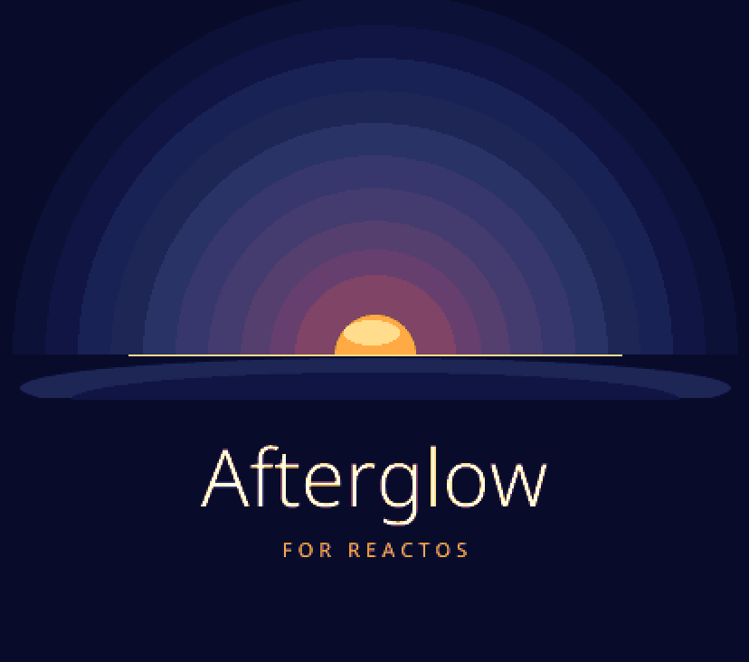

# ReactOS desktop boot logo



_The logo at 2× (828 × 732), through the colours the boot screen shows._

The art for the ReactOS 0.4.16 kernel boot screen: the logo in the middle of the screen while the system starts and on the "safe to turn off" screen. `ntoskrnl.exe` holds it as a 16-colour bitmap resource compressed with RLE4, and the Afterglow version is drawn here as a vector master and rendered by script to exactly the size, colours and format that resource uses.

## The master

`desktop/boot/boot-logo.svg` is drawn at 4× the 414 × 366 bitmap, 1656 × 1464, with the artwork written in bitmap pixels inside one `scale(4)` group. It holds ten concentric sky bands from the night blues to rose, a half-set gold sun with a lit cap, a pale gold horizon line, two dusk glow sheets under it, the word Afterglow in a light face and the line "FOR REACTOS" in small tracked capitals. Every fill is one of the 16 palette entries, so the render snaps cleanly to them. The text is outlined from Noto Sans Light and Medium, so rendering needs no font, and the master has no scripts and no embedded bitmaps. The box where the kernel draws its progress bar stays empty.

`desktop/boot/palette.json` is the palette: 16 entries with their roles, the canvas size, the slot size and the progress bar's box.

## The palette

The 16 colours of the logo bitmap are the palette of the whole boot screen, because the kernel loads that one palette and shows everything through it. The progress bar fill is drawn in code in index 15 at (259, 352), up to 121 × 12. The bar frame is a separate bitmap that uses indices 0, 2, 3, 6, 8, 9, 10, 12, 14 and 15. The line at the bottom is mostly index 13 and scrolls, and the copyright text is mostly index 15. The whole palette fades in over 12 steps of 15 ms. So the entries are in lightness order, and the roles below are fixed:

| Index | Colour    | Role in the logo                                         | Other use on the boot screen |
| ----- | --------- | -------------------------------------------------------- | ---------------------------- |
| 0     | `#080c28` | The backdrop                                             | Bar frame, screen background |
| 1     | `#0c1034` | Outermost sky band                                       |                              |
| 2     | `#101440` | Near horizon glow sheet                                  | Bar frame                    |
| 3     | `#182050` | Sky band                                                 | Bar frame                    |
| 4     | `#1c2454` | Far horizon glow sheet and sky band                      |                              |
| 5     | `#283064` | Sky band                                                 |                              |
| 6     | `#343468` | Sky band                                                 | Bar frame                    |
| 7     | `#40386c` | Sky band                                                 |                              |
| 8     | `#503c6c` | Sky band                                                 | Bar frame                    |
| 9     | `#643c68` | Rose sky band                                            | Bar frame                    |
| 10    | `#784460` | Innermost rose sky band                                  | Bar frame                    |
| 11    | `#b88838` | Not used by the logo; a deep gold the other bitmaps keep |                              |
| 12    | `#e89830` | Not used by the logo; a gold the other bitmaps keep      | Bar frame                    |
| 13    | `#fca840` | The sun and the "FOR REACTOS" line                       | The scrolling line           |
| 14    | `#fcd08c` | The sun's lit cap and the horizon line                   | Bar frame                    |
| 15    | `#fcf0dc` | The word Afterglow                                       | Progress fill, copyright     |

The VGA DAC keeps the top six bits of each channel, so every entry has its low two bits clear and what is stored is exactly what the DAC keeps. The screen then shows each six-bit value expanded back to eight bits the usual way, `(v << 2) | (v >> 4)`, which is why cream `#fcf0dc` is seen as `#fff3df`. `palette.json` states the 8-bit value stored in the bitmap, which is what the renderer and the tests use.

## The render

`desktop/boot/render.py OUT_DIR` draws the master with `rsvg-convert` at its own size, then averages each 4 × 4 block of pixels into one with a box filter. Each pixel then takes the palette entry nearest to it in six-bit space: the smallest squared distance between six-bit values wins, and a tie goes to the lower index. There is no dither. The master is flat colour, so only its edges and text need a nearer colour, and a dither would swell the RLE4 runs past the slot. Last, the progress bar's box (x 138 to 277, y 328 to 365 in the logo, which is (251, 351) to (389, 389) on a 640 × 480 screen with the logo at (113, 23)) is forced to index 0. It writes:

| File                                             | What                                                                                                                                                                                  |
| ------------------------------------------------ | ------------------------------------------------------------------------------------------------------------------------------------------------------------------------------------- |
| `afterglow-logo-rle4.bmp`                        | The bitmap the kernel resource needs: 414 × 366, 4-bit RLE4, a `BITMAPINFOHEADER`, the 16-entry palette, then bottom-up encoded runs with an end of line per row and an end of bitmap |
| `afterglow-logo-4bit.bmp`                        | The same bitmap uncompressed, rows bottom-up and padded to four bytes, for tools that do not read RLE4                                                                                |
| `afterglow-logo-1x.png`, `afterglow-logo-2x.png` | Previews at 414 × 366 and 828 × 732 through the colours the screen shows. They are not used by the system                                                                             |
| `afterglow-logo-report.txt`                      | The canvas, the indices used and the compressed size against the slot                                                                                                                 |

The resource is the part of the file from byte 14 on, the DIB without the 14-byte file header. The canvas is 414 × 366 because the "safe to turn off" screen draws the logo unclipped at (225, 114) and 415 × 366 is the most it can hold. The original resource is a 16,504-byte slot, and the compressed DIB is 11,272 bytes, 5,232 bytes under it, so the patch fits in place with room to spare. The render is deterministic: the headers carry no dates, pixel density or colour profile, so the same master gives the same bytes on every run.

The renderer fails when the master has a see-through pixel, when the RLE4 stream does not decode back to the bitmap, or when the DIB is larger than the slot. Needs `rsvg-convert` (the `librsvg2-bin` package) and Python 3 with Pillow. `bun run check:desktop` renders into a scratch folder and compares:

- **Masters.** `desktop/boot/SHA256SUMS.masters` holds the SHA-256 of the SVG and `palette.json`.
- **Renders.** `desktop/boot/SHA256SUMS` holds the SHA-256 of the two BMPs. The BMPs are not in git; the hashes are the record, and the release zip carries the files.
- **Preview.** `images/afterglow-boot-logo.png` is compared by pixels with a fresh render, since PNG encoders differ.

`node --test scripts/render-boot.test.mjs` checks the canvas and palette, that the RLE4 stream draws the same pixels as the uncompressed bitmap, that the DIB fits the slot, that the progress box is clear and that two renders give the same bytes.

## Changing the master

Edit the SVG, keeping every fill on a palette entry and the progress box empty, then render and record the new hashes:

```sh
python3 desktop/boot/render.py desktop/build/boot
(cd desktop/boot && sha256sum boot-logo.svg palette.json > SHA256SUMS.masters)
(cd desktop/build/boot && sha256sum afterglow-logo-4bit.bmp afterglow-logo-rle4.bmp > ../../boot/SHA256SUMS)
cp desktop/build/boot/afterglow-logo-2x.png docs/images/afterglow-boot-logo.png
```

Changing a palette entry changes the whole screen, so check the bar frame, the copyright text and the scrolling line against the roles above before you do.

## Branding

The logo is Afterglow's own art. It carries no ReactOS wordmark, logo or other ReactOS art, modified or not, and none was copied or traced. The only mention of ReactOS is the plain line "FOR REACTOS" in small type beneath the Afterglow name, which says what the art is for. Where a full name is wanted, in prose, use "Afterglow for ReactOS — unofficial remaster by Liminal HQ Labs", and keep "unofficial" in it. Afterglow is not affiliated with or endorsed by the ReactOS project.

## The backdrop seam

Index 0 is the backdrop of the whole boot screen, and the logon desktop that follows uses `#090e2a`. The DAC keeps the top six bits, so `#090e2a` and the stored `#080c28` are the same value to it, (2, 3, 10), and the screen shows `#080c2a`. If the colour is shown at full eight bits on the logon side, the two differ by at most two levels in one channel, which is below what the eye separates, but a visible step at the handover would be the first thing to check on a real boot.

## Patching it in

Nothing here changes a ReactOS file. Replacing bitmap 5 in `ntoskrnl.exe` (renamed `agntoskr.exe` in the remaster) happens in the `reactos-liminal` build, which owns the patched binaries and checks the input file against the ReactOS 0.4.16 hashes first (the 5,226,496-byte kernel, SHA-256 `832cedd7…8138ff`). It writes the DIB of `afterglow-logo-rle4.bmp` over the resource in place; the slot is larger than the DIB, so the rest of it is left alone. The release zip carries the BMPs, the palette and their hashes so that build can fetch them, and never a patched kernel.

The renderer was written from a spike that drew the same design directly in palette indices with 1-bit text and produced an 8,940-byte DIB. The master is a vector redraw of that design: the geometry is the same, but the text and the arc edges are anti-aliased in the master and snapped to the palette, so the bitmap is not byte for byte the spike's (about 2,200 of 151,524 pixels differ, nearly all on the text and the arc edges) and compresses to 11,272 bytes. The palette is also the spike's with each entry cleared to six bits, at most 3 levels per channel.
