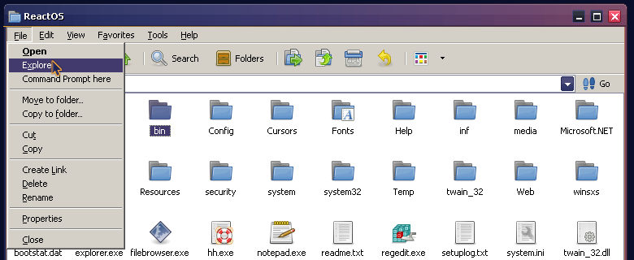
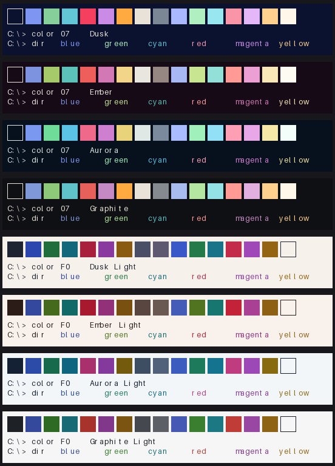
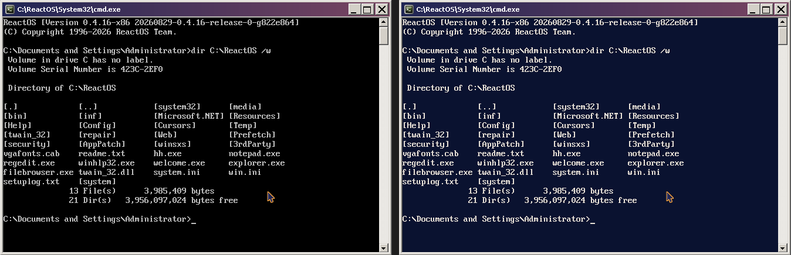

# ReactOS desktop colour schemes

The Afterglow visual style for ReactOS 0.4.16 (`afterglow.msstyles`) holds eight colour schemes in one size (Normal). **Dusk** is the default, then **Ember**, **Aurora** and **Graphite**, and a light version of each: **Dusk Light**, **Ember Light**, **Aurora Light** and **Graphite Light**. The generator and its sources are in `desktop/`; see `desktop/README.md` to build the style.

## The schemes

| Scheme             | Caption ramp                                                   | Accent (Start button, ink line, default ring, tick) | Taskbar              | Close               |
| ------------------ | -------------------------------------------------------------- | --------------------------------------------------- | -------------------- | ------------------- |
| **Dusk** (default) | `#1f2554` navy to `#7a4562` rose                               | gold `#ffaa40`                                      | `#0c0c10`            | rose `#f43f5e`      |
| Ember              | `#2b1330` aubergine through burnt orange to coral `#ab4b3a`    | pale gold `#f3d58a`                                 | `#110c0b`            | crimson `#c41e3a`   |
| Aurora             | `#0e2238` teal-navy through teal to violet `#4b3d86`           | mint `#7be3c8`                                      | `#070b14`            | magenta `#d0508f`   |
| Graphite           | `#1e2126` charcoal through slate to warm grey `#585451`        | gold `#ffaa40`                                      | `#0d0d0e`            | muted red `#b5473f` |
| Dusk Light         | `#f6dcc8` peach to `#d0c6e2` lilac, navy title text            | gold `#ffaa40`                                      | cream to lavender    | soft rose `#e0607a` |
| Ember Light        | `#f7e3d3` apricot to `#e4ab9c` coral, aubergine title text     | gold `#e8b85a`                                      | warm cream           | crimson `#c41e3a`   |
| Aurora Light       | `#dff3ef` mint ice to `#d8cbea` lavender, teal-navy title text | mint `#3cc6a4`                                      | cool light grey-blue | magenta `#d0508f`   |
| Graphite Light     | `#f2f2f3` to `#ccc8c4` pale greys, charcoal title text         | gold `#ffaa40`                                      | light grey           | muted red `#b5473f` |

Title text meets 4.5:1 on every caption ramp step in all eight schemes; the generator refuses to build otherwise. In every scheme the system colours an application paints with stay the classic cream scheme, so application client areas do not change.

## Applying a scheme

There are three routes. The registry route is the safe one.

1. **Registry (recommended).** Copy `afterglow.msstyles` to `C:\ReactOS\Resources\Themes\Afterglow\`, import `desktop/install/afterglow-original.reg` once (it selects the style with the Dusk scheme, sets the caption metrics, and carries Dusk's desktop, selection and console colours), then import the scheme you want and log off and on again:

   ```bat
   desktop\schemes\apply-scheme.cmd ember /logoff
   ```

   The argument is the file stem of a `desktop/schemes/*.reg` file: `dusk`, `ember`, `aurora`, `graphite`, `dusk-light`, `ember-light`, `aurora-light` or `graphite-light`. Each file sets the theme manager's `ColorName`, the six title colours, the desktop and selection colours of the classic scheme and the console colour table (see below). The theme takes effect at the next logon; the console colours are read by each new console window.

2. **By hand.** Import the scheme's `.reg` file with `regedit /s`.

3. **Display Properties, Appearance, Color scheme.** The list shows all eight names, sorted, and applies the pick at once without logging off: the theme reloads in every process and the scheme's system colours are copied into the classic scheme.

## Desktop and selection colours

Each scheme also sets three values of `HKCU\Control Panel\Colors`, all generated by `desktop/style/gen.py`: `Background`, the desktop colour seen while the wallpaper loads and at log-off (Dusk's is `#090e2a`, the wallpaper's horizon; the light schemes take a mid tint of their caption ramp), and `Hilight` with `HilightText`, the selection bar of lists, trees, menus and desktop icon labels with its text. `Hilight` is the fourth step of the control ramp (Dusk `#42396c`; the light schemes use their dark scheme's, so a selection stays visible on cream) and the text is white, 6.9:1 or better. `MenuHilight` and `MenuBar` are not set: a boot with loud values for both (red and green) changed neither the menu bar nor the menu highlight, so ReactOS ignores them here, and menus follow `Hilight`. 

The colours of the logon screen come from `win32k.sys` and are not touched.

## Console colours

`desktop/style/agconsole.py` draws a 16-colour console palette for every scheme from the scheme's own slots: the background is the scheme's tile navy (Dusk `#0a1230`), the foreground a warm off-white (the text colour pulled a third of the way to the pale gold), the yellows are the gold accent, the reds the close-button rose, and the greens, cyans, blues and magentas are written once per scheme in `CONSOLE_HUES`. The light schemes get a light console (ink on the cream paper, `ScreenColors` `0xF0`) with dark hues. The generator fails the build when any text colour is below 4.5:1 on the screen background, or the popup colours are.





ReactOS's console server reads `HKCU\Console` when a console window opens: `ColorTable00` to `ColorTable15` (`0x00BBGGRR`), `ScreenColors` and `PopupColors` (an attribute byte, background in the high nibble). Plain `HKCU\Console` is enough: in a ReactOS 0.4.16 boot, a new `cmd.exe` opened from the Run box took the table at once, with no per-title key (such as `HKCU\Console\C:_ReactOS_System32_cmd.exe`) and no log-off; windows that are already open keep their colours. The console font stays ReactOS's own (`FaceName` `VGA`); nothing in the registry file touches it.

`python3 desktop/style/render-console.py OUT.png` redraws the preview, and `bun run check:desktop` checks the committed PNG and every generated `.reg` file.

## Scroll bars

By default the scroll bars are the classic Windows ones (cream faces with raised two-pixel edges, black arrows, the dithered track), the same in every scheme. The Afterglow scroll bars (dusk thumbs and gold hot states) are kept in the generator and built on request: `bash desktop/style/build.sh desktop/build --scrollbars`.

The style cannot simply leave scroll bars out. `uxtheme` paints a window's own scroll bars only through the style's `SCROLLBAR` class and has no classic fallback: without the class a themed window gets no arrow buttons and its thumb leaves trails when it moves. So the default style carries a `SCROLLBAR` class drawn to look classic (`style/ini/scroll-classic.ini`), and the grip parts say `BgType = None` because a part with no section is drawn as a default white box. Standalone scroll bar controls and every other control (spin buttons, combo drop-down buttons, list, tree and header controls) are unaffected: none of them use the `scroll/` images.

## Live switching caveat

Switching colour schemes live in Display Properties reloads the theme in every running process. In testing, many live switches in a row crashed `win32k` once. A single switch is normally fine, but for scripted or repeated changes use the registry route and log off, which loads the scheme once at logon and was stable throughout.

## How the engine holds them

`uxtheme` reads three lists from resource id 1: `COLORNAMES` and `SIZENAMES` (null-separated names, the first is the default) and `FILERESNAMES` (one INI resource name per colour and size pair). `OpenThemeData` uses `ColorName` and `SizeName` from `HKCU\Software\Microsoft\Windows\CurrentVersion\ThemeManager`. Image names in an INI become resource names, so per-scheme bitmaps are differently named resources, and an image whose bytes equal one already drawn is shared. Display names come from string 1000 + n and tooltips from 2000 + n.

## Pointers

The pointer set is separate from the colour schemes and the same in every one. See `docs/reactos-desktop-pointers.md`. The icon set is described in `docs/reactos-desktop-icons.md`.

The boot logo shares the dusk palette but has its own 16 colours, in [reactos-desktop-boot.md](reactos-desktop-boot.md).

## Where the colours come from

See `desktop/PROVENANCE.md`.
