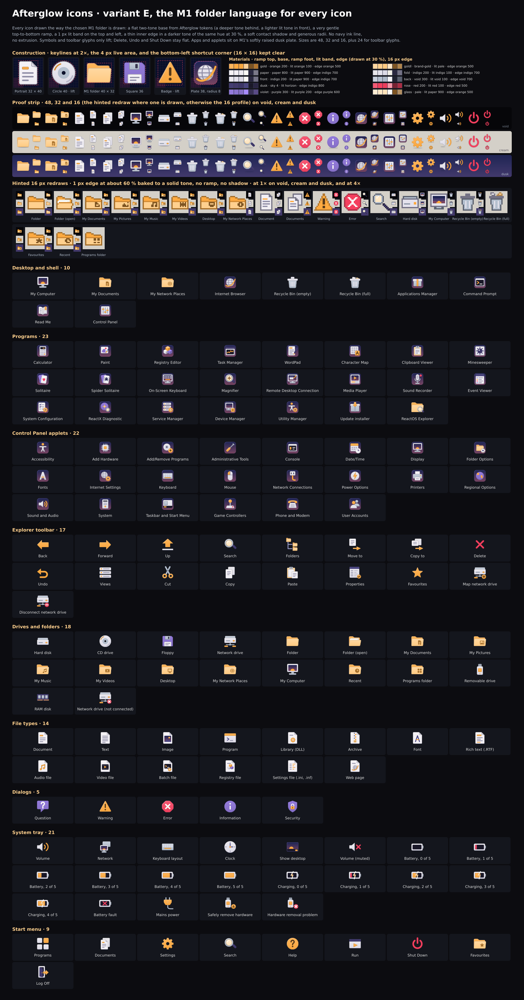
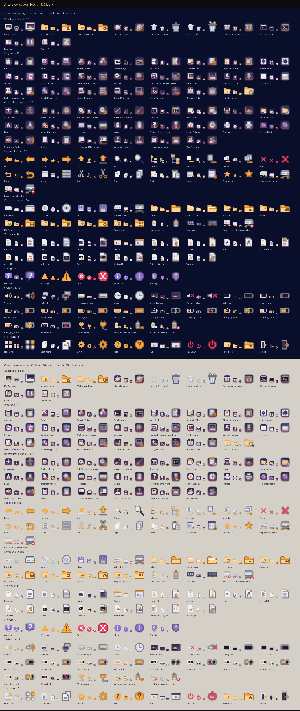

# ReactOS desktop icons



_The contact sheet, rendered from the vector masters._

The Afterglow icon set for ReactOS: 135 icons in nine groups (desktop and shell, programs, Control Panel applets, Explorer toolbar, drives and folders, file types, dialogs, system tray and the Start menu) and the shortcut arrow, drawn on a 48 px grid as vector masters and rendered down by script to 16, 32 and 48 px. The whole set is drawn in the language of the folder (variant E, after the folder called G-M1). Quill's own icons are not part of it.

## Design rules

**The language.** Every icon has a flat two-tone base from the Afterglow tokens (a deeper tone behind, a lighter one in front), a very gentle top-to-bottom ramp, a 1 px lit band on the top and left, a thin inner edge in a darker tone of the same hue, a soft contact shadow and generous rounded corners. There is no ink outline and no extrusion: depth comes from a front face over a back face, and the edge is clipped inside the face so the silhouette never grows. Apps and applets sit on the same softly raised dusk plate as Folder Options. Gold is the one accent, rose is for delete, error and shut down, and shape rather than colour separates the dialog badges. The bottom-left corner (16 × 16 at 48, 11 × 11 at 32, 8 × 8 at 16) is plain on every icon, because ReactOS draws the shortcut arrow there.

**The tiers and sizes.** Body objects (folders, documents, drives, monitors, bins) get a 30 % contact shadow. Symbols, dialog badges and toolbar glyphs only lift, with a 20 % shadow, and Delete, Undo and Shut Down are flat stroke marks. The edge is 1 px at 30 % at 48, 1 screen pixel at 45 % at 32 and a baked solid tone at 16, where the ramp, lit band and shadow are dropped. 24 px is not drawn because ReactOS never asks for it.

## The folders

Folder, Folder (open), My Documents, My Pictures, My Music, My Videos, Desktop, My Network Places, Folder Options and Folders are exactly G-M1: one sheet with a sloped tab and a separate flap. `gen_e.py` imports `folders_g.py` and renders it with M1's own tags, so they cannot drift from the chosen design. The special folders (My Documents, My Pictures, My Music, My Videos, Desktop and My Network Places) are the closed folder with an embossed emblem. The open folder is delivered but ReactOS 0.4.16 rarely shows it: only the file dialog's Look in list and regedit ask for it. The Recycle Bin is two icons, empty and full, because it is the one icon ReactOS changes with its contents.

## The shortcut arrow

`arrow.ico` is the overlay ReactOS draws over a shortcut's icon. It is the original A1 paper coin: a paper disc with a tinted indigo edge, a dusk-navy straight diagonal arrow and a slim soft shadow at 48 and 32. The owner chose it after exploring other badges, obtuse arrow heads and bent elbows (`arrows.py` keeps those options, but nothing shipped uses them). The stock overlay, shell32 group 30, has only 16 and 32 px frames, so at Shell Icon Size 48 ReactOS stretches the 32 px frame and blurs it; `arrow.ico` has real 16, 32 and 48 px frames, with each size's shadow baked in and none at 16. The 16 px frame is drawn pixel by pixel. All the art sits inside the stock boxes (16 × 16, 11 × 11 and 8 × 8, bottom-left), so no icon loses more than it does today, and a test checks it.


_The arrow composited the way ReactOS does it: at the top left of a frame of the same size._

The arrow reads at 13.9:1 on its coin. The coin is light, so its separation comes from the tinted edge: 1.9:1 against the gold back of the folder, 2.5:1 against the gold front and 3.5:1 against paper. That edge is the weak point on light and gold icons, where the coin is almost the same tone as what it sits on, and at 16 px the edge is a single pixel ring. On the dark desktop and on the dusk app plate the paper coin stands out strongly.

To use it, replace shell32 group 30, which is the `Shell Icons` registry value `29` (`HKLM\Software\Microsoft\Windows\CurrentVersion\Explorer\Shell Icons`), with `ico/arrow.ico`. ReactOS composites the overlay at paint time over the icon at the same size, so it has to be 32-bit at every size.

## Sizes and the render

Every icon ships at 16, 32 and 48 px, drawn from the master built for that size:

| Size  | Drawn from                                                                                    |
| ----- | --------------------------------------------------------------------------------------------- |
| 48 px | `svg/ID.svg`, the master                                                                      |
| 32 px | `svg/32/ID.svg`, the 32 px profile (still a 48 viewBox, with its own edge)                    |
| 24 px | `svg/24/ID.svg`, the 24 px profile, for the 18 Explorer toolbar glyphs only                   |
| 16 px | `svg/ID-16.svg`, the hinted redraw, for the 20 icons that have one; otherwise `svg/16/ID.svg` |

The hinted 16 px redraws are pixel drawings: Folder, Folder (open), My Documents, My Pictures, My Music, My Videos, Desktop, My Network Places, Document, Documents, Warning, Error, Search, Hard disk, My Computer, both Recycle Bins, Favourites, Recent and the Programs folder. `desktop/icons/render.py OUT_DIR` runs `rsvg-convert` on each, which bakes each size's own blur for the shadows, and writes `png/ID-SIZE.png` (426 files), one `ico/ID.ico` per icon (136 files with the arrow) and, for each toolbar glyph, `ico24/ID.ico` with its one 24 px frame (18 files). An `.ico` holds the three frames, smallest first, as uncompressed 32-bit BGRA DIB frames with alpha and an all-zero AND mask: the classic layout that old icon loaders read, with no PNG-compressed frames. The output has no dates, so the same masters and the same `rsvg-convert` give the same bytes. The `.ico` bytes were identical with `rsvg-convert` 2.58 and 2.63; the PNG files are written as `rsvg-convert` makes them and are not hashed. The files are named by the icon ids, so a build recipe can pick `ico/folder.ico` by id. The `.ico` hashes are in `desktop/icons/SHA256SUMS`, and `bun run check:desktop` renders them again and compares.

```sh
python3 desktop/icons/render.py desktop/build/icons    # ico/, ico24/, png/, afterglow-icons-sheet.png and afterglow-arrow-preview.png
python3 desktop/icons/contact.py desktop/build/icons docs/images/afterglow-icons-contact.png
```

## The map

[`map.json`](../desktop/icons/map.json) lists every icon id, and the arrow, with its label, its group and what it replaces in ReactOS. A `status` of `named` means a ReactOS object is named; `unmapped` means none is yet (Clock, Show desktop, Network in the tray and Security, which ReactOS 0.4.16 does not draw from a resource). A `resource` names the module and icon group to replace, or for the Explorer toolbar the four `browseui.dll` bitmap strips (214 and 215 at 24 px, 216 and 217 at 16 px) and the cell index; `also` lists more groups or cells that take the same icon, each with what uses it. Every id carries its evidence: `source` (the ReactOS 0.4.16 source at tag `0.4.16-release`: the resource headers and `.rc` files, `hivecls.inf`, `shortcuts.inf` and the `*ImageIndex` constants in `browseui/toolsband.cpp`) and `binary` (the stock 0.4.16 i386 file holds that group). Spider Solitaire and Sound Recorder are `source` only, because the stock files at hand did not include them. 130 icons carry a resource, and no group or cell is claimed by two icons; a test checks both. The build that applies the icons is the reactos-liminal one.

## Icons v2

The second pass draws the icons ReactOS still showed in its stock art once set E was applied, from the reactos-liminal icon survey's lists of missing art and from what the 0.4.16 Start menu installs (`shortcuts.inf`). They are drawn in `desktop/icons/gen_v2.py` with set E's own Pen, materials, profiles, dusk plate and shadows, so nothing about the language changes; the three new special folders add their emblems to the M1 folder's emblem tables. Set E's 73 masters and `.ico` files are byte for byte what they were.

- **Programs (23).** Calculator, Paint, Registry Editor, Task Manager, WordPad, Character Map, Clipboard Viewer, Minesweeper, Solitaire, Spider Solitaire, On-Screen Keyboard, Magnifier, Remote Desktop Connection, Media Player, Sound Recorder, Event Viewer, System Configuration, ReactX Diagnostic, Service Manager, Device Manager, Utility Manager, the update installer and ReactOS Explorer. Applications Manager, Internet Browser and Read Me were in set E and now carry their ids.
- **Control Panel applets (3).** Game Controllers, Phone and Modem, User Accounts.
- **Shell and Start menu (4).** Favourites, Recent and the Programs folder (M1 folders with a star, clock and grid emblem, each with a hinted 16 px redraw) and Log Off.
- **Drives (3).** Removable drive (a flash stick), RAM disk (a memory module) and the network drive that is not connected.
- **File types (6).** Audio, video, batch, registry, settings (`.ini`, `.inf`) and web page files.
- **Explorer toolbar (7).** Cut, Copy, Paste, Properties, Favourites, Map network drive and Disconnect network drive: every cell `toolsband.cpp` uses now has an Afterglow glyph. All 18 toolbar glyphs also get a 24 px profile, because the large strips are 24 px.
- **Tray (16).** Volume muted, the six battery levels, the five charging levels, battery fault, mains power, and safely remove hardware with its problem state, from `stobject.dll`.

Existing icons were also given the ids the survey and the stock files verify: the drives, the Start menu items, the applets, the file types, the dialog icons in `user32.dll` (101 to 104) and the toolbar cells.

**Left out, and why.** No Afterglow art goes in `user32.dll` group 105 (`IDI_WINLOGO`, the ReactOS logo), or in the Mouse Keys tray states (`stobject.dll` 440 to 449: 16 px, 8-bit only, so they have no 32-bit frame id to reuse). History and full screen are not drawn: no 0.4.16 toolbar button uses them, and their strip cells are not named in `toolsband.cpp`. The 24 px hot strips take the same cells as the normal ones, because Afterglow draws no hot state. Help Viewer, Volume Control, the Keyboard Layout Switcher, `control.exe`, `netshell.dll` and the CSIDL_DRIVES, NetHood and Entire Network folders take existing icons (Help, Sound and Audio, Keyboard layout, Control Panel, Network Connections, My Computer and My Network Places) through `also`.

**Design choices.** One variant of each was drawn; the review of the first pass changed two. ReactX Diagnostic first had a white cross on a violet disc, which read as Close or Error, so it became a gold four-point sparkle on the disc with a lens. Paint's brush first ran past the plate's top-right corner; it was turned so the tip points at the canvas and the handle stays inside. Cut's blades and rings were drawn heavier after the first render, because at 16 px the thin strokes left no solid pixel. The removable drive is a flash stick rather than a cartridge drive, the RAM disk a memory module, and the network drive states share one drive with a gold plus (map), a rose minus (disconnect) or a rose cross (not connected).



_The system contact sheet, drawn by `desktop/icons/contact.py` from the render._

## Vector masters

All the art is vector. `desktop/icons/gen_e.py` is the canonical source for the icons: it draws every icon and the sheet, and writes `icons/` (the 48 px masters, the `32/`, `24/` and `16/` profiles and the hinted `ID-16.svg` redraws, 443 files) and `sheet.svg`. It imports `folders_g.py` and `gen_v2.py` beside it for the folder family. `desktop/icons/arrows.py` is the canonical source for the arrow (`arrows.py --variant A1 --out DIR` writes the three masters in `desktop/icons/arrow/`); the copy keeps its other variants and its own sheet code, which this repository does not use. The committed [`desktop/icons/svg/`](../desktop/icons/svg/), `desktop/icons/sheet.svg` and `desktop/icons/arrow/` are their output, kept so the masters can be opened and diffed without running anything. Edit the generators, not the SVGs: `bun run check:desktop` regenerates them and fails when they differ from the committed files, and `desktop/icons/SHA256SUMS.masters` records their hashes. Rasters are always rendered from the masters and never edited by hand.

```sh
python3 desktop/icons/gen_e.py OUT_DIR    # writes OUT_DIR/icons/ and OUT_DIR/sheet.svg
python3 -B desktop/icons/arrows.py --variant A1 --out OUT_DIR/arrow
cp -r OUT_DIR/icons/. desktop/icons/svg/ && cp OUT_DIR/sheet.svg desktop/icons/sheet.svg
cp OUT_DIR/arrow/arrow-48.svg OUT_DIR/arrow/arrow-32.svg OUT_DIR/arrow/arrow-16-hinted.svg desktop/icons/arrow/
(cd desktop/icons && find svg arrow -type f | LC_ALL=C sort | xargs sha256sum > SHA256SUMS.masters && sha256sum sheet.svg gen_e.py gen_v2.py folders_g.py arrows.py >> SHA256SUMS.masters)
```

The sheet's text uses whatever sans-serif the renderer finds, so the contact sheet PNG in `docs/images/` is a picture for the docs and is not compared byte for byte.

## Licence

The art, the generators and the renderer are original to this repository and licensed Apache-2.0 OR MIT, (c) Copyright 2026 Liminal HQ, Scott Morris, like the rest of it (`LICENSE-APACHE`, `LICENSE-MIT`); each SVG carries the header. No ReactOS, Windows or third-party icon was copied, traced or recoloured, and the arrow is not the stock bitmap. The design follows public guidance (Microsoft Learn's app icon design and construction pages, Fluent 2's iconography notes) for grids, radii, sizes and light direction, and nothing from them is reproduced. ReactOS itself is GPL and LGPL code: the icons are separate files, and this repository does not ship a patched ReactOS binary.
