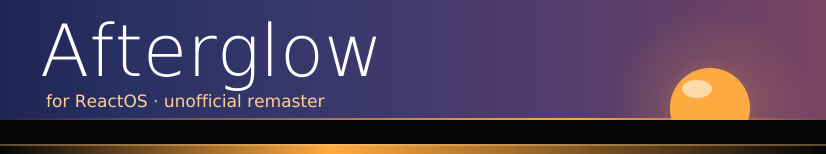

# ReactOS desktop logon banner



_The banner and the bar under it, at 2× (826 × 144 and 826 × 10)._

The art for the top of the ReactOS 0.4.16 logon boxes: the Welcome (Ctrl-Alt-Delete) box, the Logon box, the "Please wait…" status box, Security, Locked, Unlock and Change Password. `msgina.dll` draws all of them with two bitmap resources, a banner and a bar, and the Afterglow versions are drawn here as vector masters and rendered to exactly the size and format those resources use.

## The masters

The masters are in `desktop/logon/`, drawn at 4× the size they ship at so they can be reduced without losing the edges:

| File           | What                                                                                                                                                            | Size       |
| -------------- | --------------------------------------------------------------------------------------------------------------------------------------------------------------- | ---------- |
| `banner-a.svg` | The banner: the Afterglow wordmark in a light face over the dusk sky with a setting sun. This is the design that ships                                          | 1652 × 288 |
| `bar.svg`      | The strip under the banner: a dark band with a gold line that fades out to both sides                                                                           | 1652 × 20  |
| `banner-b.svg` | The fallback banner, a Liminal HQ Labs wordmark in the same layout and size. It is kept as a master only: nothing renders or ships it unless the design changes | 1652 × 288 |

The text in every master is outlined from DejaVu Sans (the DejaVu font licence allows embedding outlines), so rendering needs no font. Edit the masters in a vector editor and keep that rule, then follow [Changing a master](#changing-a-master).

## The render

`desktop/logon/render.py OUT_DIR` draws the masters with `rsvg-convert` at their own size, then averages each 4 × 4 block of pixels into one with a box filter, and writes:

| File                                                                                                 | What                                                                                                                                                                                    |
| ---------------------------------------------------------------------------------------------------- | --------------------------------------------------------------------------------------------------------------------------------------------------------------------------------------- |
| `afterglow-banner.bmp`                                                                               | 413 × 72, 24-bit, uncompressed, rows bottom-up and padded to four bytes. Replaces the `IDI_ROSLOGO` bitmap (resource 20000)                                                             |
| `afterglow-bar.bmp`                                                                                  | 413 × 5, 24-bit, uncompressed. Replaces the `IDI_BAR` bitmap (resource 20001). The width stays 413 because the status box scrolls the bar 7 pixels at a time and 413 is a multiple of 7 |
| `afterglow-banner-2x.png`, `afterglow-banner-4x.png`, `afterglow-bar-2x.png`, `afterglow-bar-4x.png` | Previews at 826 and 1652 pixels wide, for docs and review. They are not used by the system                                                                                              |
| `afterglow-logon-preview.png`                                                                        | The banner over the bar at 2×: the picture at the top of this page                                                                                                                      |

The sizes and the 24-bit depth are those of the stock `msgina.dll` bitmaps, and a same-size, same-depth replacement written in place into a copy of `msgina.dll` was shown working in a booted guest. The BMP header carries no dates, pixel density or colour profile, so the same masters give the same bytes on every run. Both masters are fully opaque, and the renderer stops if a pixel is not, because a BMP has nothing to blend it with.

Needs `rsvg-convert` (the `librsvg2-bin` package) and Python 3 with Pillow. `bun run check:desktop` renders into a scratch folder and compares:

- **Masters.** `desktop/logon/SHA256SUMS.masters` holds the SHA-256 of the three SVG files. A changed master fails the check and names the file.
- **Renders.** `desktop/logon/SHA256SUMS` holds the SHA-256 of the two BMPs. The BMPs themselves are not in git; the hashes are the record, and the release zip carries the files.
- **Preview.** `images/afterglow-logon-banner.png` is compared by pixels with a fresh render, since PNG encoders differ.

## Changing a master

Edit the SVG, then render and record the new hashes:

```sh
python3 desktop/logon/render.py desktop/build/logon
(cd desktop/logon && sha256sum banner-a.svg banner-b.svg bar.svg > SHA256SUMS.masters)
(cd desktop/build/logon && sha256sum afterglow-banner.bmp afterglow-bar.bmp > ../../logon/SHA256SUMS)
cp desktop/build/logon/afterglow-logon-preview.png docs/images/afterglow-logon-banner.png
```

## Branding

The banner is Afterglow's own art. It carries no ReactOS wordmark, logo or other ReactOS art, modified or not, and none was copied or traced. The only mention of ReactOS is the plain line "for ReactOS · unofficial remaster" in small type beneath the Afterglow name, which says what the art is for and that it is not an official ReactOS release. Where a full name is wanted, in prose, use "Afterglow for ReactOS — unofficial remaster by Liminal HQ Labs", and keep "unofficial" in it. Afterglow is not affiliated with or endorsed by the ReactOS project.

## Patching it in

Nothing here changes a ReactOS file. Replacing the two bitmaps in `msgina.dll` (renamed `agmsgina.dll` in the remaster) happens in the `reactos-liminal` build, which owns the patched binaries and checks the input file against the ReactOS 0.4.16 hashes first. The release zip carries the BMPs and their hashes so that build can fetch them.
