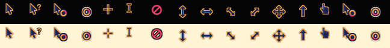
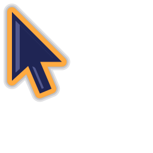
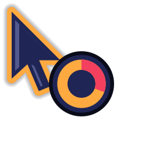
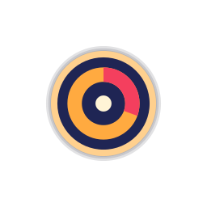
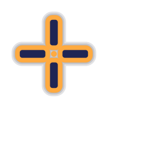
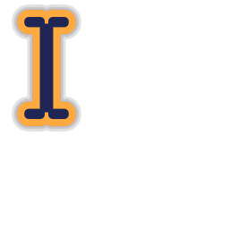
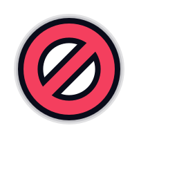
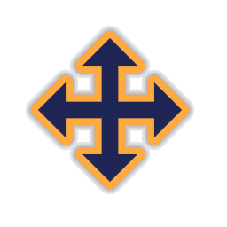

# ReactOS desktop pointers


_The Afterglow pointers at 8×, on the dark desktop colour. Each pixel of the 32 × 32 art is an 8 × 8 block. The faint tan edge on cream is the pointers' own soft dark halo._


_The same pointers at 8×, on cream._



_The same pointers at true size, on the dark desktop colour and on cream._

The exact art is in [`images/pointers/`](images/pointers/): one transparent PNG per pointer at 8× (`arrow.png`, `help.png` and so on), and `working-frames.png` and `busy-frames.png` with all eight frames of each animated pointer. `desktop/pointers/render-preview.py` draws all of these images from the same generator code, with whole-number nearest-neighbour scaling and no resampling.

The Afterglow mouse pointers for ReactOS 0.4.16: 14 pointers at the standard size (32 × 32 images, with the footprint and hot spot of the stock ReactOS pointer each one replaces, not enlarged), drawn procedurally by `desktop/pointers/gen-cursors.py`. Each has a dusk-navy body with a soft gold rim, a light highlight and a faint dark halo, so it reads on a dark desktop and on a white page.

| File                                             | Pointer                                        |
| ------------------------------------------------ | ---------------------------------------------- |
| `afterglow-arrow.cur`                            | Normal select                                  |
| `afterglow-help.cur`                             | Help select                                    |
| `afterglow-working.cur`                          | Working in background                          |
| `afterglow-busy.cur`                             | Busy (a Quill ring)                            |
| `afterglow-cross.cur`                            | Precision select                               |
| `afterglow-ibeam.cur`                            | Text select                                    |
| `afterglow-no.cur`                               | Unavailable                                    |
| `afterglow-size-ns.cur`, `-we`, `-nwse`, `-nesw` | Resize vertical, horizontal and both diagonals |
| `afterglow-move.cur`                             | Move                                           |
| `afterglow-up.cur`                               | Alternate select                               |
| `afterglow-hand.cur`                             | Link select                                    |

The generator also writes an 8-frame `afterglow-working.ani` and `afterglow-busy.ani`, for systems that play animated pointers.

## SVG masters

The pointers that ship are the 32 × 32 raster files from the generator. The repository also holds vector masters of the same 14 pointers in `desktop/pointers/svg/`, drawn from the same shape definitions (polygons, circles and strokes) in a 32 × 32 viewBox, so the art survives a larger size or a new target. They are reference art: raster is what ships (`.cur`, `.ani`, and the sheet above), vector is the scalable source.

|  |  |  |  |  |  |  |
| ---------------------------------------------------------------------------- | -------------------------------------------------------------------------- | -------------------------------------------------------------------------------- | -------------------------------------------------------------------------- | -------------------------------------------------------------------------------- | --------------------------------------------------------------------------- | ------------------------------------------------------------------------------- |
| Arrow                                                                        | Help                                                                       | Working                                                                          | Busy                                                                       | Crosshair                                                                        | Text                                                                        | Unavailable                                                                     |

|  |  |  |  |  |  |  |
| ---------------------------------------------------------------------------------------- | ------------------------------------------------------------------------------------------ | --------------------------------------------------------------------------------------- | --------------------------------------------------------------------------------------- | -------------------------------------------------------------------------- | ---------------------------------------------------------------------------- | -------------------------------------------------------------------------- |
| Resize vertical                                                                          | Resize horizontal                                                                          | Resize NW-SE                                                                            | Resize NE-SW                                                                            | Move                                                                       | Up arrow                                                                     | Hand                                                                       |

_The vector masters, rendered by your browser (not the shipped raster)._

- **Idealised, not pixel-identical.** The raster reduces from 8× supersampling and filters its rim, halo and highlight; the SVG says the same with strokes and a few translucent layers. At 32 × 32 the two overlap about 87% on average (the diagonal resizes, the move pointer and the crosshair differ most, in rim shape and edge pixels).
- **Hot spot.** Each file carries `data-hotspot="x,y"` and says it in its `<title>` and `<desc>`, in the pointer's own pixel grid.
- **Animations.** `afterglow-working-animated.svg` and `afterglow-busy-animated.svg` turn the travelling arc with SMIL (eight steps, 0.1 s each, as in the `.ani` files). The eight frames of each are in `pointers/svg/frames/`.
- **Generated.** `python3 desktop/pointers/gen-cursors.py OUT_DIR --svg desktop/pointers/svg` rewrites them, and `bun run check:desktop` regenerates and compares them with the committed files. Edit the generator, not the SVGs.

## Generating them

Needs Python 3 with numpy and Pillow. The pointer binaries are generated and stay out of git.

```sh
python3 desktop/pointers/gen-cursors.py desktop/build/pointers                   # 14 .cur and 2 .ani files
python3 desktop/pointers/gen-cursors.py desktop/build/pointers --sheet sheet.png  # also a contact sheet on three backgrounds
```

The output is deterministic: `desktop/pointers/SHA256SUMS` records the hash of all 16 files and `bun run check:desktop` redraws them and compares. The hashes were recorded with Pillow 13.0.0; a different Pillow can resample differently, in which case regenerate the sums after looking at the contact sheet.

## The pointer scheme in the Mouse control panel

`desktop/pointers/afterglow-pointers.reg` lists an "Afterglow" scheme under `HKCU\Control Panel\Cursors\Schemes` and selects it. Copy the generated files to `C:\ReactOS\Cursors\Afterglow\`, then import the file (`regedit /s afterglow-pointers.reg`). The scheme then shows in Control Panel, Mouse, Pointers. The scheme names the static busy pointers, because that dialog shows no preview for `.ani` files.

## Making them the system pointers: patch-user32.py

ReactOS 0.4.16 never applies a pointer scheme. `User32SetupDefaultCursors` says "FIXME load system cursor scheme", `SPI_SETCURSORS` is unimplemented and `SetSystemCursor` cannot replace a cursor once one is loaded, so the system pointers always come from the cursor resources inside `user32.dll`. The registry scheme above is therefore only a listing. To change what the desktop actually shows, `desktop/pointers/patch-user32.py` appends the 14 images to a copy of `user32.dll` in a new `.agcur` section and points the cursor groups at them (28 group ids, because `user32.rc` carries each pointer twice). Nothing else in the file moves, and the PE checksum is recomputed.

```sh
python3 desktop/pointers/patch-user32.py USER32_COPY desktop/build/pointers USER32_PATCHED
```

- **Tool only.** The patch operates on a copy that you supply and writes a separate output; it refuses to write over its input. A patched `user32.dll` is ReactOS code (LGPL-2.1) with these images added. This repository never contains one and you should not publish one: patch your own copy, on your own demo disk. Copy the result over `C:\ReactOS\system32\user32.dll` on the disk (for example with mtools while the guest is off) and reboot.
- **Only one build is accepted.** The tool checks the input's size and SHA-256 and refuses anything else with exit code 4. It was written against the `user32.dll` of ReactOS 0.4.16 for i386, as found in the 0.4.16 install ISO (`reactos/system32/user32.dll`) and in a fresh install: 1,604,096 bytes, SHA-256 `8ddd64afb96b576f899e3d73ea3a44355474f6c74a3ccd3ff75caa696b711958`. Other versions, other architectures and nightly builds have different cursor ids and section layouts and are not supported.
- **Already patched files** are recognised (exit code 3) and left alone; to change the pointers, patch the original copy again.
- **Reproducible.** With the pointers from this generator the patched file is 1,665,024 bytes with SHA-256 `31f2137f45e8e15f3478333150d67996c7566e426ea7856e860a293a8ef7d477` (`desktop/pointers/SHA256SUMS.user32`). `USER32=PATH bun run check:desktop` patches a scratch copy of your `user32.dll` and compares.
- **Static system pointers.** `user32` resources hold static cursors only, so the system busy pointer does not animate.

## Light and dark

One pointer set serves every colour scheme: the gold rim and dark halo keep each pointer legible on the dark Dusk, Ember, Aurora and Graphite desktops and on the cream client areas and light schemes. A light variant (a cream body with a navy rim) would suit the four light schemes a little better, but it would also need a second set of resources in `user32.dll`, because the pointers cannot follow the colour scheme at run time. Not built yet.

## Where the art comes from

See `desktop/PROVENANCE.md`: the pointers are original, drawn from polygons, circles and strokes defined in the generator, and no Lunar, Mizu, Blackshade or other pointer set was used.
