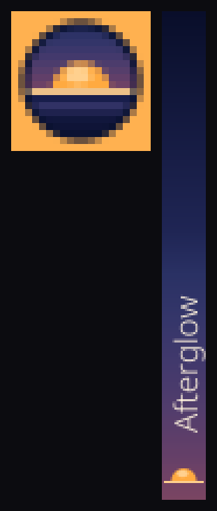

# ReactOS desktop Start orb and menu banner



_The orb as it sits on the Start button (10×, the 20 × 20 square explorer shows) and the menu banner (3×)._

The art for the Start button and the strip down the left of the Start menu in the ReactOS 0.4.16 `explorer.exe`: the Afterglow dusk badge, a navy disc with a gold sun half set on its horizon, and a banner of the same dusk with the Afterglow name. Both are drawn here as vector masters and rendered to exactly the size and format those two bitmap resources use.

## The resources

| Resource   | What                  | Format                                                                                                                    |
| ---------- | --------------------- | ------------------------------------------------------------------------------------------------------------------------- |
| Bitmap 143 | The Start button orb  | 25 × 20, 32-bit with straight alpha, bottom-up, size field 2,000. One image for every button state (normal, hot, pressed) |
| Bitmap 158 | The Start menu banner | 21 × 233, 24-bit with no alpha, bottom-up, size field 14,914 (14,912 bytes of rows and two trailing bytes)                |

## Constraints

- **The orb is 20 × 20.** Explorer loads bitmap 143 as an image list with a cell width of 0, which makes each cell as wide as the image is high, so only columns 0 to 19 are shown and the five columns on the right are never drawn. The art must sit inside that 20 × 20 square with at least a 1 px transparent margin all round (so inside the 18 × 18 square at columns and rows 1 to 18), and columns 20 to 24 stay clear. An earlier orb was centred in the whole 25 px width and was clipped on the right for that reason. The renderer stops if any pixel outside the 18 × 18 square has alpha.
- **One image, three states.** The orb is not redrawn for hot or pressed: the button draws its own frame around it. Keep the orb readable on both the gold of the button and the darker pressed state.
- **Straight alpha.** The 32-bit pixels are not premultiplied, and fully transparent pixels are zero. The renderer averages the edge pixels weighted by alpha so the rim keeps its colour.
- **The banner's top matches the menu.** The strip sits flush with the top of the menu, so its first row is the menu's navy, `#090e2a`, and the dusk warms toward the foot. A test asserts the top row.
- **Bottom-up, no file header.** Both outputs are resource-ready DIBs (a `BITMAPINFOHEADER` and the bits), the form the resource holds, not `.bmp` files.

## The masters

The masters are in `desktop/start/`, drawn at 8× the size they ship at so they can be reduced without losing the edges:

| File         | What                                                                                                                                                                                                                                                  | Size       |
| ------------ | ----------------------------------------------------------------------------------------------------------------------------------------------------------------------------------------------------------------------------------------------------- | ---------- |
| `orb.svg`    | The dusk badge: a vertical dusk gradient in a disc (centre 10, 10, radius 8.6 in bitmap pixels), a gold half-set sun with its lit cap up and left, a pale horizon line and a violet band beneath it, ringed by a thin edge in the tile navy `#0a1230` | 200 × 160  |
| `banner.svg` | The strip: the dusk gradient from navy at the top, a small half-set sun and horizon at the foot, and the name Afterglow in a light face reading from the bottom up                                                                                    | 168 × 1864 |

The depth language is the house one: light comes from the upper left (the sun's lit cap sits up and left), the edge is a thin tinted line and there is no black ink line. The colours are the Afterglow desktop tokens in `desktop/boot/palette.json` (the dusk ramp, the gold `#ffaa40` and its light `#ffd08e`, the tile navy and the horizon violet). The wordmark is outlined from Noto Sans Light (the Noto font licence allows embedding outlines), so rendering needs no font. The masters have no scripts and no external references.

## The render

`desktop/start/render.py OUT_DIR` draws each master with `rsvg-convert` at its own size, averages every 8 × 8 block into one pixel in integer arithmetic and writes:

| File                                | What                                                                                     |
| ----------------------------------- | ---------------------------------------------------------------------------------------- |
| `start-orb.dib`                     | 2,040 bytes: the 40-byte header and the 25 × 20 bits. For bitmap 143                     |
| `start-banner.dib`                  | 14,954 bytes: the header and the 21 × 233 bits with the stock size field. For bitmap 158 |
| `start-orb.png`, `start-banner.png` | The two images at their own size, for review                                             |
| `afterglow-start-preview.png`       | The picture at the top of this page                                                      |

The same masters give the same bytes on every run. Needs `rsvg-convert` (the `librsvg2-bin` package) and Python 3 with Pillow. `bun run check:desktop` renders into a scratch folder and compares:

- **Masters.** `desktop/start/SHA256SUMS.masters` holds the SHA-256 of the two SVG files.
- **Renders.** `desktop/start/SHA256SUMS` holds the SHA-256 of the two DIBs. The DIBs themselves are not in git; the hashes are the record, and the release zip carries the files.
- **Preview.** `images/afterglow-start.png` is compared by pixels with a fresh render.

## How it compares with the preview

The earlier orb and banner were drawn in pixels by a spike script and patched into `explorer.exe` in a preview VM. These masters reproduce that design from its geometry (the dusk ramp, the sun, the horizon and the edge, with the disc re-centred in the 20 × 20 square). The orb matches the preview's orb in design and placement but not byte for byte: antialiasing differs on the rim and the horizon, where a few pixels differ by up to 74 channel levels, and the banner's wordmark is unhinted vector text where the spike's was hinted bitmap text, so its letters sit within a pixel of the preview's.

## Changing a master

Edit the SVG, then render and record the new hashes:

```sh
python3 desktop/start/render.py desktop/build/start
(cd desktop/start && sha256sum banner.svg orb.svg > SHA256SUMS.masters)
(cd desktop/build/start && sha256sum start-banner.dib start-orb.dib > ../../start/SHA256SUMS)
cp desktop/build/start/afterglow-start-preview.png docs/images/afterglow-start.png
```

## Patching it in

Nothing here changes a ReactOS file, and this render has not been patched into `explorer.exe` here. Replacing bitmaps 143 and 158 in the explorer (renamed `agexplorer.exe` in the remaster) happens in the `reactos-liminal` build, which owns the patched binaries and checks the input file against the ReactOS 0.4.16 hashes first. The release zip carries the DIBs and their hashes so that build can fetch them.

## Branding

The orb and banner are Afterglow's own art. They carry no ReactOS wordmark, logo or other ReactOS art, modified or not, and none was copied or traced. Afterglow is not affiliated with or endorsed by the ReactOS project.
